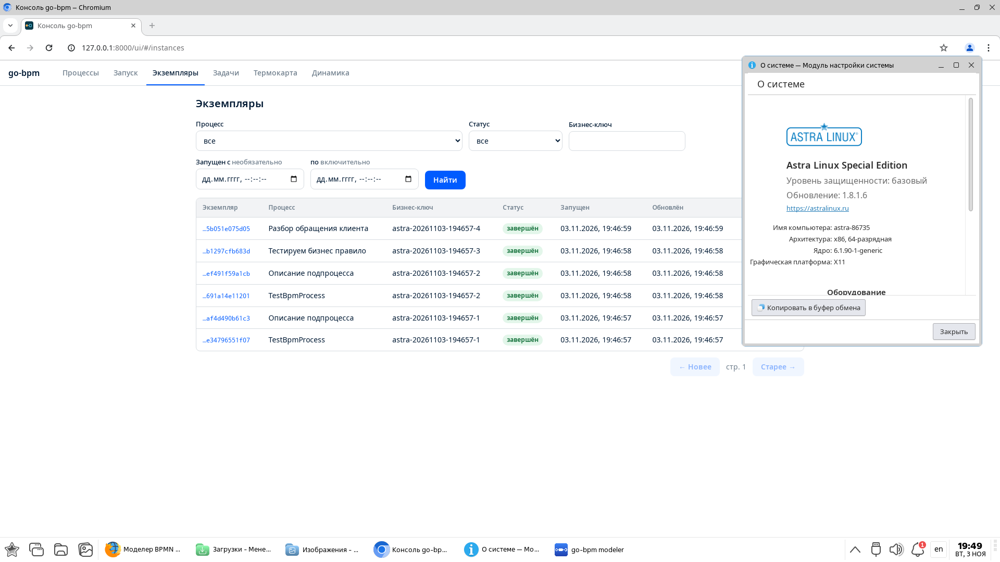
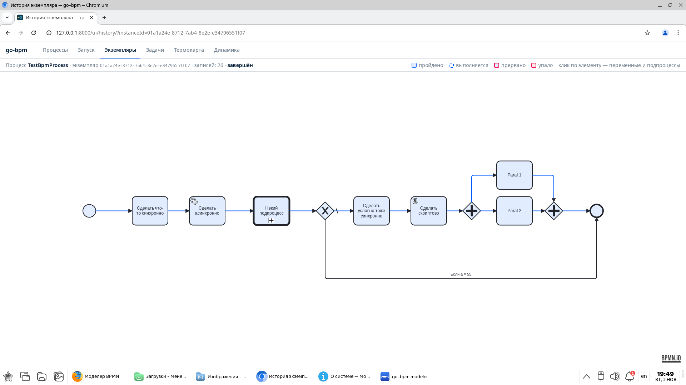
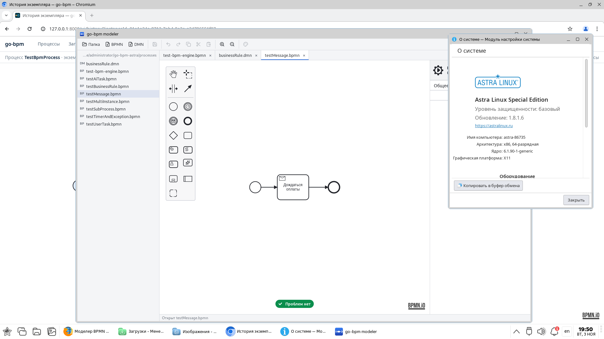
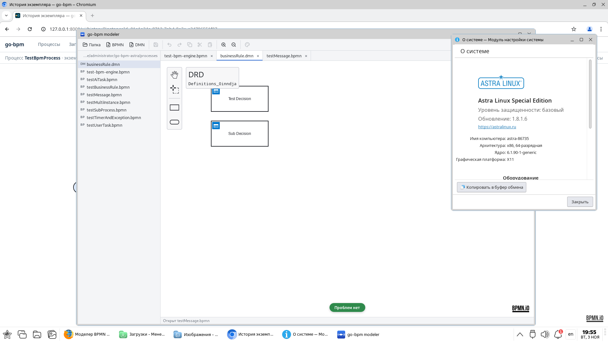

# Совместимость с Astra Linux

go-bpm проверен на **Astra Linux Special Edition 1.8.1, обновление 1.8.1.6**, архитектура x86-64.
На стенде запущены движок с PostgreSQL, веб-консоль и настольный go-bpm modeler.
Проверенные процессы BPMN и бизнес-правила DMN исполнились успешно.

Проверка проведена **3 ноября 2026 года**. Ниже — конфигурация стенда, результаты и оригинальные
скриншоты рабочего стола Astra Linux.

## Конфигурация стенда

| Компонент | Версия |
|---|---|
| Операционная система | Astra Linux Special Edition 1.8.1, обновление 1.8.1.6 |
| Уровень защищённости | Базовый |
| Архитектура | x86-64 |
| Ядро Linux | 6.1.90-1-generic |
| База данных | PostgreSQL 15.6, штатный пакет Astra `15.6-astra.se2` |
| Движок go-bpm | [Коммит 73e9a5a](https://github.com/nicolas-vp/go-bpm/commit/73e9a5a25c1606f95bbdff667a20169fcd419505), сборка Go с `CGO_ENABLED=0` |
| go-bpm modeler | [Сборка dev-1b67aca](https://github.com/nicolas-vp/go-bpm-modeler/commit/1b67acae1603dd2935cde3159947b630353a1845), Linux amd64 |

Движок и моделер работают непосредственно в Astra Linux, без Docker.
Для проверки использована отдельная тестовая база PostgreSQL. Исходный код продукта для запуска на Astra Linux не менялся.

## Движок, BPMN и DMN

Через HTTP API запущены четыре сценария. Для каждого проверены итоговый статус `completed`
и наличие истории исполнения в PostgreSQL, включая дочерние процессы.

| Сценарий | Что проверено | Результат |
|---|---|---|
| `TestBpmProcess`, `amount = 1` | Скрипт, параллельные ветки и вызов подпроцесса | Завершён; 49 записей истории с дочерними процессами |
| `TestBpmProcess`, `amount = 55` | Альтернативная ветка процесса | Завершён; 36 записей истории с дочерними процессами |
| `TestDecision`, `a = foo`, `b = bar` | Выполнение бизнес-правил DMN | Завершён; 7 записей истории |
| `TestAiTask` | Исполнение AI task со штатным демонстрационным клиентом `aistub` | Завершён; 9 записей истории |

Веб-консоль отображает завершённые экземпляры и схему с пройденными элементами.
На снимке ниже рядом с консолью открыто штатное окно «О системе»: видны редакция ОС,
обновление 1.8.1.6 и версия ядра.

[Открыть скриншот консоли и версии ОС в полном размере](/static/images/astra-console-version.png).

На схеме `TestBpmProcess` видны успешно пройденная ветка, вызов подпроцесса и параллельные задачи.
Статус экземпляра — «завершён».

[Открыть скриншот истории в полном размере](/static/images/astra-bpmn-history.png).

## Настольный моделер

Опубликованная сборка go-bpm modeler для Linux amd64 запускается с системными библиотеками Astra Linux.
Проверены чтение рабочей папки, открытие схем BPMN и диаграммы решений DMN, отображение элементов
и результатов линтера. Для процесса ожидания оплаты `testMessage.bpmn` линтер показывает «Проблем нет».

[Открыть скриншот моделера BPMN в полном размере](/static/images/astra-modeler-bpmn.png).

[Открыть скриншот моделера DMN в полном размере](/static/images/astra-modeler-dmn.png).

## Область проверки

Результаты подтверждают тестовый запуск указанных сборок и выполнение перечисленных сценариев
на Astra Linux Special Edition 1.8.1.6 с базовым уровнем защищённости.
Это собственная проверка проекта; она не является сертификацией со стороны производителя ОС.

В этот прогон не входили нагрузочные испытания, восстановление после сбоев, другие версии ОС
и уровни защищённости, редактирование и сохранение схем в моделере, его MCP-сервер и подключение
реальной внешней AI-модели. Полная проверка всех возможностей продукта не проводилась.

Чтобы попробовать go-bpm, начните с [быстрого старта](/docs/quickstart/).
Сборки редактора доступны на странице [go-bpm modeler](/modeler/),
настройки движка описаны в разделе [«Запуск и эксплуатация»](/docs/running/).
