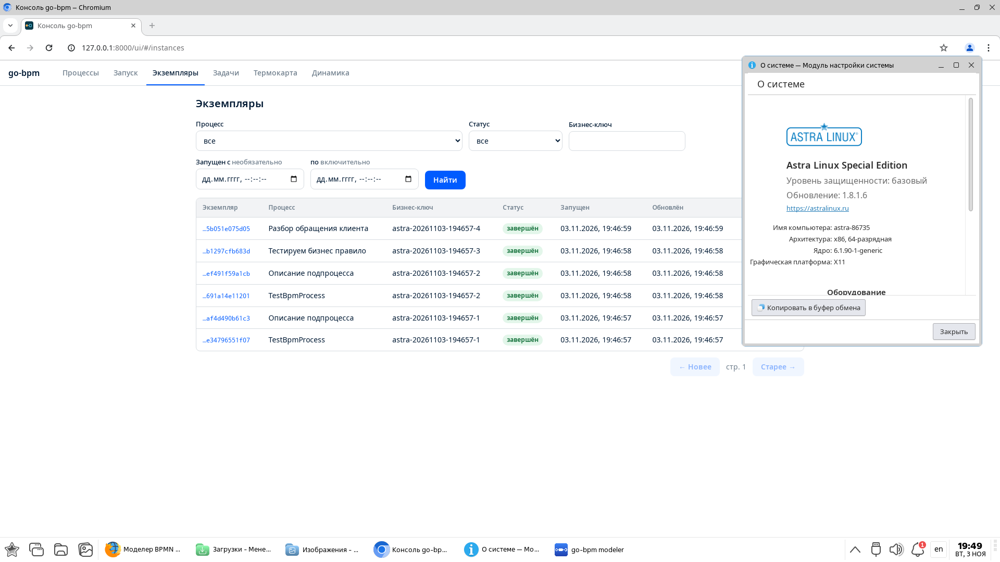
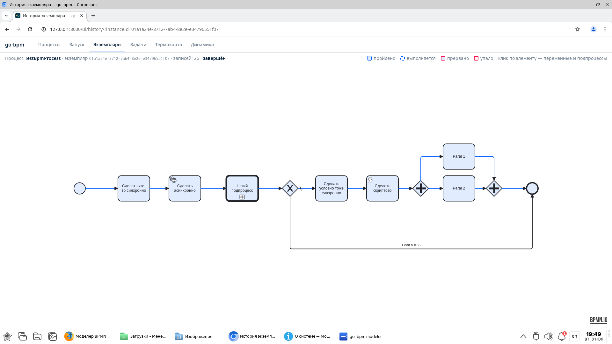
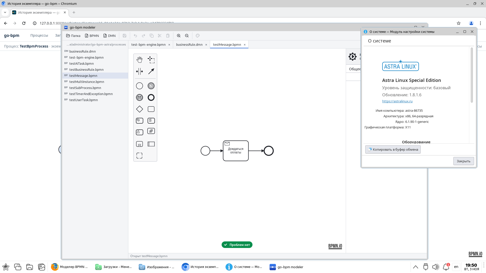
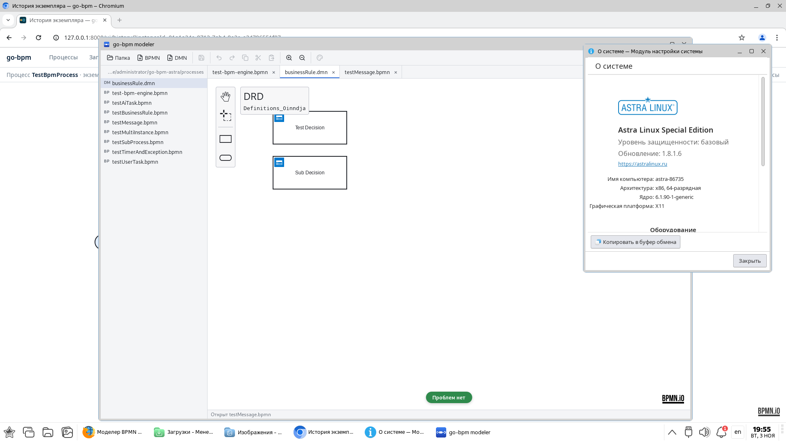

# Astra Linux compatibility

go-bpm was tested on **Astra Linux Special Edition 1.8.1, update 1.8.1.6**, x86-64. The engine with PostgreSQL, web console and desktop modeler ran successfully in the tested scenarios on **3 November 2026**.

## Test environment

| Component | Version |
|---|---|
| OS | Astra Linux Special Edition 1.8.1, update 1.8.1.6 |
| Security level | Basic |
| Architecture | x86-64 |
| Kernel | 6.1.90-1-generic |
| Database | PostgreSQL 15.6, Astra package `15.6-astra.se2` |
| Engine | [73e9a5a](https://github.com/nicolas-vp/go-bpm/commit/73e9a5a25c1606f95bbdff667a20169fcd419505), built with `CGO_ENABLED=0` |
| Modeler | [dev-1b67aca](https://github.com/nicolas-vp/go-bpm-modeler/commit/1b67acae1603dd2935cde3159947b630353a1845), Linux amd64 |

The engine and modeler ran directly on Astra Linux without Docker, using a separate test database. No product source changes were required.

## Engine, BPMN and DMN

Each HTTP-started scenario reached `completed`, with PostgreSQL history including child instances.

| Scenario | Coverage | History records |
|---|---|---|
| `TestBpmProcess`, `amount=1` | Script, parallel branches and call activity | 49 |
| `TestBpmProcess`, `amount=55` | Alternative branch | 36 |
| `TestDecision`, `a=foo`, `b=bar` | DMN decisions | 7 |
| `TestAiTask` | AI tasks with the standard `aistub` demo client | 9 |

[Open full-size console and OS screenshot](/static/images/astra-console-version.png).

[Open full-size history screenshot](/static/images/astra-bpmn-history.png).

## Desktop modeler

The published Linux amd64 modeler launched with Astra's system libraries. Workspace reading, BPMN and DMN opening, element display and linter results were checked. The payment-waiting diagram `testMessage.bpmn` reported no problems.

[Open full-size BPMN screenshot](/static/images/astra-modeler-bpmn.png).

[Open full-size DMN screenshot](/static/images/astra-modeler-dmn.png).

## Scope of the check

These results establish that the specified builds launched and the listed scenarios executed on the tested OS and basic security level. This is the project's own compatibility check, not OS vendor certification.

The run did not cover load testing, failure recovery, other OS releases or security levels, modeler editing/saving, its MCP server or a real external AI model. It was not an exhaustive product test.

Continue with the [quick start](quickstart.md), [modeler downloads](/en/modeler/) or [operations guide](running.md).
