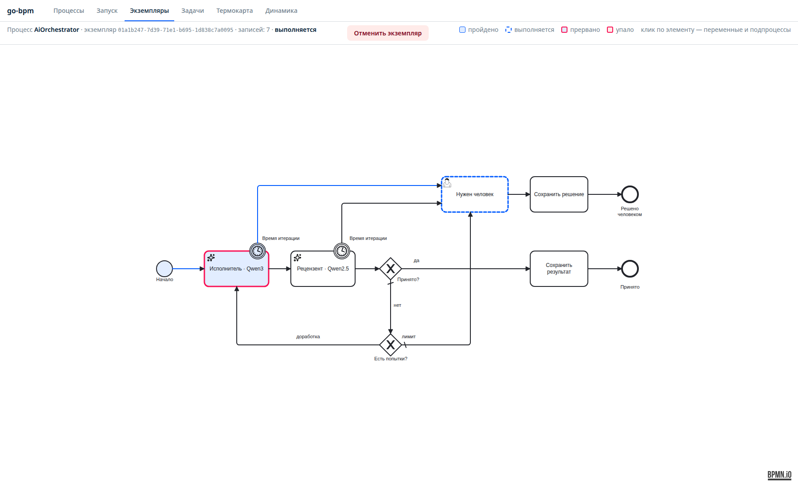
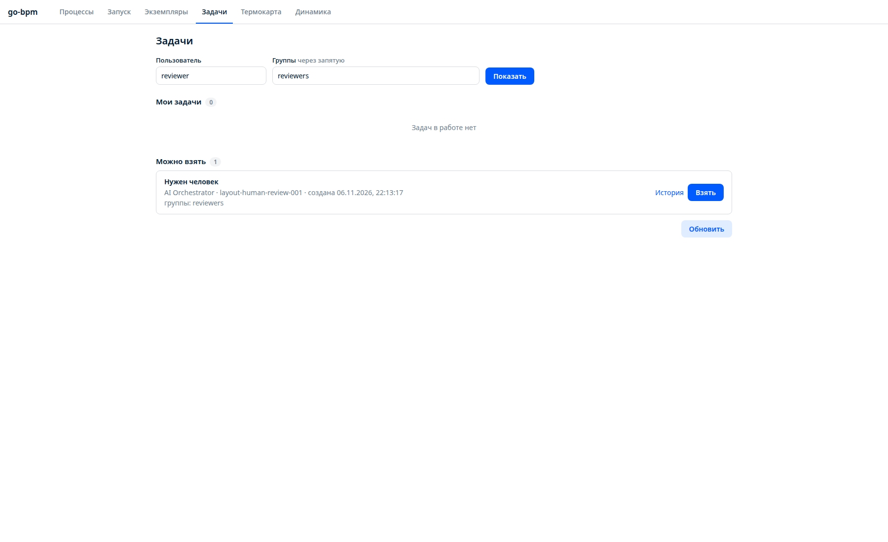
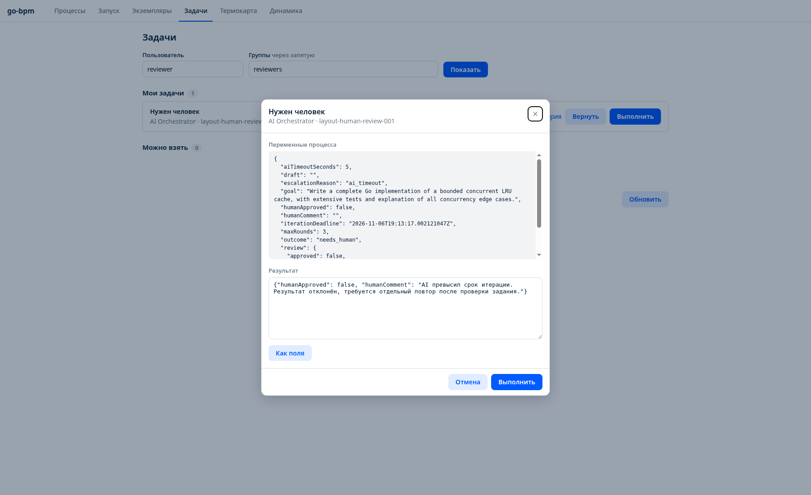

# BPMN for LLM orchestration

An AI model writes code, another reviews it, and rejected drafts return for revision. A useful workflow also needs persisted progress, bounded attempts, deadlines and human escalation. This teaching project models that workflow in BPMN and runs it with go-bpm and PostgreSQL.

[Source and setup](https://github.com/nicolas-vp/go-bpm-ai-orchestrator) · [BPMN](https://github.com/nicolas-vp/go-bpm-ai-orchestrator/blob/main/process/orchestrator.bpmn) · [Experiment records](https://github.com/nicolas-vp/go-bpm-ai-orchestrator/tree/main/docs/experiment)

## Workflow

1. The executor receives a goal and writes a draft.
2. An independent reviewer reads the goal and draft and returns approval or feedback.
3. Rejected work returns to the executor with the previous draft and feedback.
4. On a deadline or iteration limit, the process creates a human task and waits for a reviewer.

BPMN makes routing visible; PostgreSQL retains progress across application restarts. Attempt limits belong to the program rather than relying on a model to remember them. The experiment was inspired by [Why AI Agents Need Orchestration](https://camunda.com/blog/2025/02/why-ai-agents-needs-orchestration/).



[Open the full diagram](/static/images/go-bpm-ai-orchestrator/layout-04-timeout.png).

The models only return text. They do not run commands, edit files or interact with GitHub. Compilation, tests and deployment are not included in this workflow.

## Model roles and state

| Role | Experiment model | Input | Output |
|---|---|---|---|
| Executor | `qwen3-coder:30b-32k` | Goal, previous draft, feedback | Text in `draft` |
| Reviewer | `qwen2.5-coder:32b-8k` | Goal and latest draft | JSON `approved` and `feedback` |

Calls use Ollama. The test machine had an RTX 3090 with 24 GB VRAM; Qwen3 used all 49 GPU layers and a 32,768-token context, and the reviewer used 8,192. Calls were sequential with `keep_alive:0`, so both models did not need to remain loaded together. These are experiment settings, not a performance benchmark.

## Revision, retry and timeout

| Situation | Mechanism |
|---|---|
| Valid reviewer response with `approved:false` | Another revision, up to `maxRounds` |
| HTTP error, empty/truncated/invalid response | Queue retry, configured for two attempts |
| Iteration deadline expires | Interrupt the AI activity and create a human task |
| Deadline or iteration limit | Wait for group `reviewers` |

The default is three iterations, with `maxRounds` allowed from one to five. Each executor/reviewer pair shares `aiTimeoutSeconds`, default 120 seconds, allowed from one to 600. If execution takes 90 seconds, review has 30 seconds left. Revision starts a new deadline. Both activity timers reference `iterationDeadline`.

An interrupted BPMN branch does not guarantee that Ollama computation stops. A late result is discarded and cannot revive the interrupted branch or overwrite a human decision. The separate HTTP attempt timeout is ten minutes.

Transition handlers update the iteration count and escalation reason. The incoming executor transition validates settings and prepares the deadline:

```go file=examples/go-bpm-ai-orchestrator/prepare.go.txt decl=prepare
```

The generated limit condition:

```go file=examples/go-bpm-ai-orchestrator/cond_limit.go.txt decl=limit
```

## Human decisions

While waiting for a person, instance status is `running`, `outcome` is `needs_human`, and `escalationReason` is `ai_timeout` or `iteration_limit`.



User `reviewer` from `reviewers` claims the task and completes it using the console's ordinary variable editor:

```json
{"humanApproved":false,"humanComment":"Iteration deadline exceeded; reject this result and review the task before retrying."}
```



| Outcome | Meaning | Instance status |
|---|---|---|
| `accepted` | LLM reviewer approved | `completed` |
| `needs_human` | Awaiting a person | `running` |
| `approved_by_human` | Human accepted | `completed` |
| `rejected_by_human` | Human rejected | `completed` |

Pass `humanApproved:true` explicitly to approve. Otherwise the existing process variable applies, normally false. Human approval completes the process rather than starting another model iteration. Exhausted technical retries produce `failed`, a separate result.

## Model approval does not establish correctness

In the `UniqueSorted` experiment, the executor revised its draft and the reviewer approved code that did not compile. A second model's judgment is still probabilistic. For code-producing workflows, compilation, tests and static checks need explicit deterministic steps before acceptance. This example demonstrates orchestration, not an automatic guarantee of valid code.

## Run the example

Follow the repository setup for PostgreSQL, Ollama and the required model tags. To exercise a deadline on a running local service:

```sh
curl -XPOST localhost:8092/api/v1/processes/AiOrchestrator/instances \
  -H 'Content-Type: application/json' \
  -d '{"businessKey":"timeout-example","variables":{"goal":"Write a complete Go implementation of a bounded concurrent LRU cache, with extensive tests and explanation of all concurrency edge cases.","aiTimeoutSeconds":5}}'
```

Open `/ui/history/?instanceId=<returned id>`. If generation exceeds five seconds, claim the human task as `reviewer` in `reviewers`. A short request may complete before the timer; the timer does not insert an artificial delay.

## Validation and scope

Six deterministic PostgreSQL scenarios passed with Go's race detector: immediate acceptance, revision and acceptance, iteration-limit human approval/rejection, executor timeout and reviewer timeout. Timeout tests hold the model response until the human decision completes, then verify that the late response cannot alter the outcome or comment, and no active timer remains.

Generation, build, `go vet` and CI also passed. State survived an application restart; after restoring Ollama, a failed task was retried in the same instance. Real models were tested separately. Local Go/PostgreSQL execution was checked; the container image and Compose startup were not checked in that experiment.

Screenshots and source refer to [4ff7fd1](https://github.com/nicolas-vp/go-bpm-ai-orchestrator/commit/4ff7fd1), 6 November 2026. See [AI tasks](bpmn.md#ai-tasks), [user task APIs](api.md) and [testing](testing.md).
