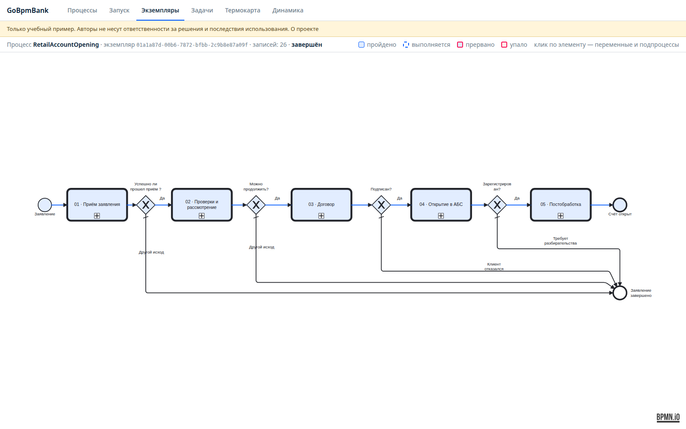
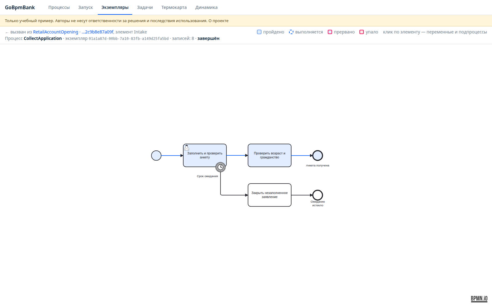
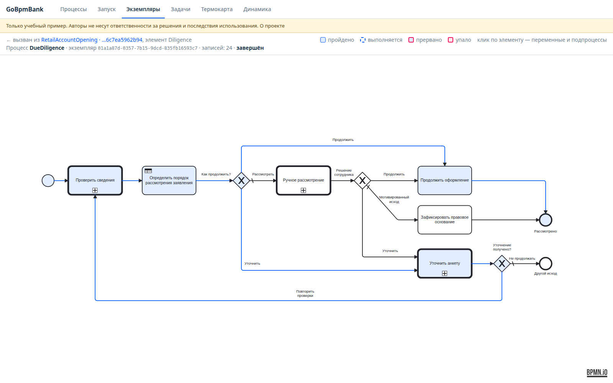
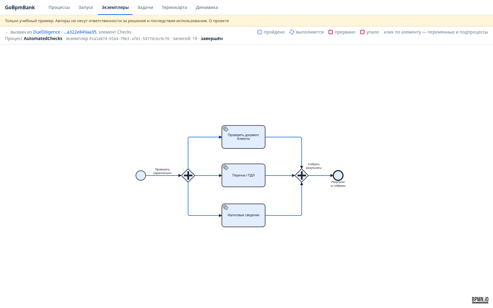
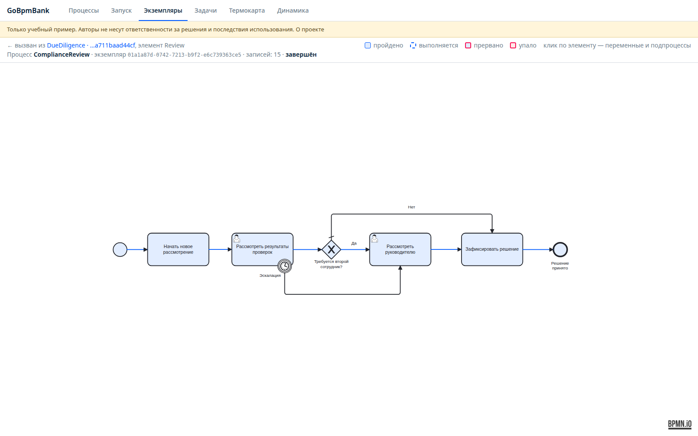
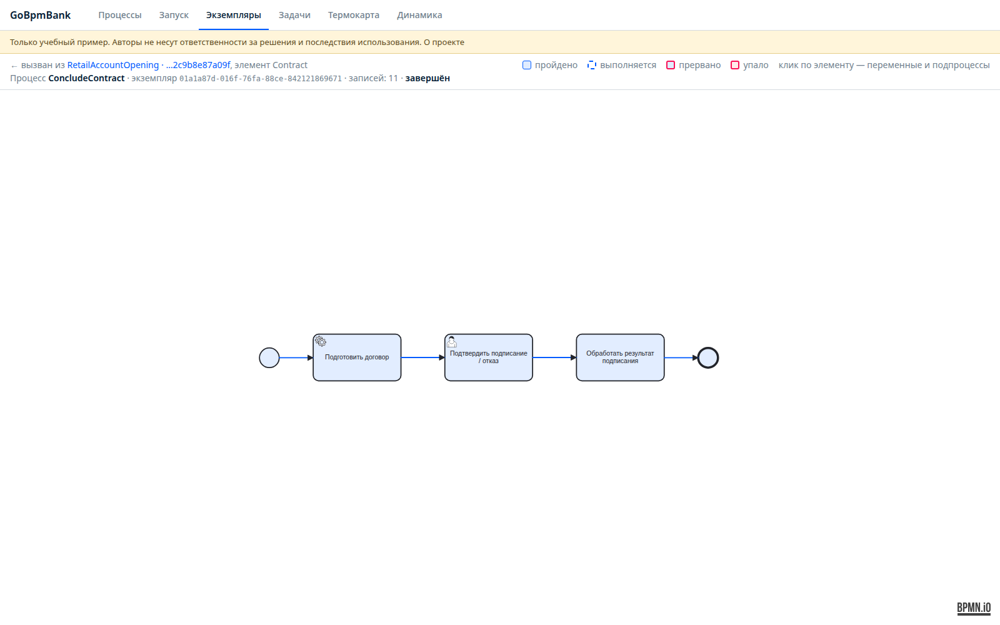
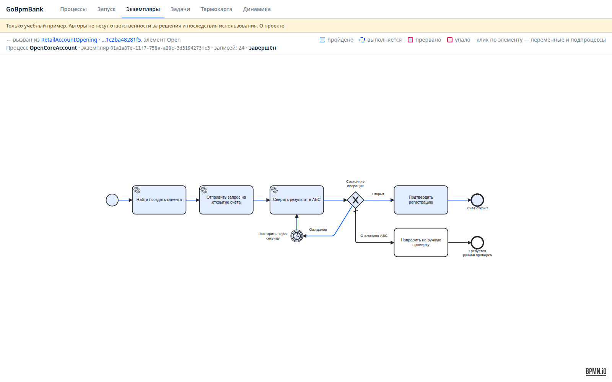
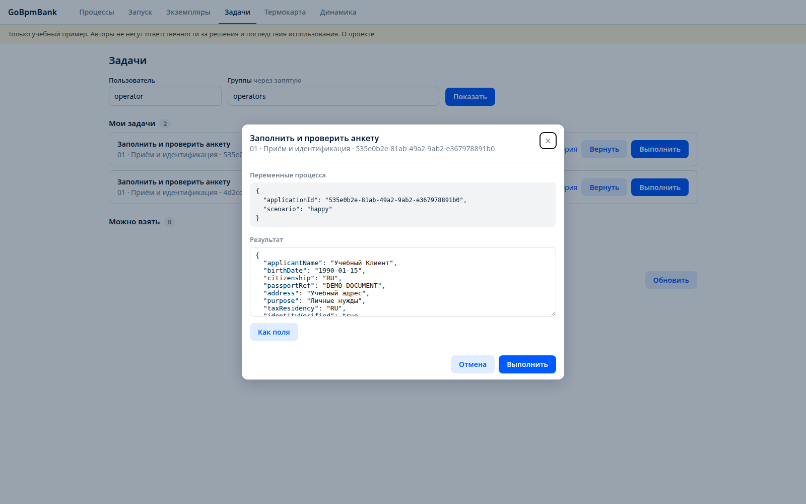

# A teaching example: opening a bank account

> **For educational use only.** GoBpmBank demonstrates go-bpm; it is not a production banking system, legal advice or an account-opening procedure. The authors accept no responsibility for decisions based on the example or the consequences of its use. It opens no real accounts and sends no information to public authorities. Use fictional data only.

GoBpmBank follows an application through subprocesses, parallel checks, DMN routing, employee decisions and a mock core banking integration, including recovery from a lost response.

The scenario covers a new adult Russian citizen applying in person for a ruble current account for personal use. It excludes credit, deposits, card issuance, representatives, minors and remote identification. Citizenship alone does not establish tax residency.

[Source repository](https://github.com/nicolas-vp/go-bpm-bank) · [BPMN support](bpmn.md) · [API and console](api.md)

## Architecture

One parent process calls seven processes. A separate mock core banking HTTP service uses a separate PostgreSQL database. Staff complete tasks through the standard console variable editor, without custom forms or `formKey`.

The project is a standalone clone of go-bpm with the engine, generator, API and console. Baseline demo processes are removed. Applications retain business keys, child links, element history and matched rules.



## 1. Define the scenario

Separate legal reference material, the teaching bank's internal policy and technical behavior. A questionnaire deadline is an internal SLA; an HTTP timeout is a technical failure; a customer declining a contract is a distinct business outcome.

The original model's research is dated 4 November 2026 and refers to Russian account-opening, identification, internal-control, tax-information and personal-data rules. It does not establish regulatory completeness or replace a bank's approved procedures. Its routing sends possible list matches and politically exposed person cases for review rather than treating them as automatic refusals.

`NK142_4_NO_TAX_DATA` is an internal teaching code for one modeled refusal reason, not an official classification or exhaustive catalog. The corresponding Russian reference page contains the dated source discussion; review current rules independently before any practical application.

## 2. Split the process

| Process | Responsibility |
|---|---|
| `RetailAccountOpening` | Coordinate stages and business outcomes |
| `CollectApplication` | Questionnaire, identity confirmation, age and citizenship scope |
| `DueDiligence` | Checks, DMN, requests for information and manual review |
| `AutomatedChecks` | Parallel document, list/PEP and tax-information checks |
| `ComplianceReview` | Review results and obtain a second approval when needed |
| `ConcludeContract` | Prepare the contract and record signing or withdrawal |
| `OpenCoreAccount` | Request opening and verify registration in the mock system |
| `PostOpening` | Archive the file and confirm mock reporting and notification |

Each call activity creates a child instance with its own history and returns variables to the parent. Generated code comes from the diagrams in `process/`; clients and application validation are handwritten.

The operator confirms identity and questionnaire completeness. Out-of-scope applications are referred to a specialist, while a boundary timer closes an unfilled application after the teaching deadline.

<details>
<summary>Application intake</summary>



</details>

Due diligence runs three checks in parallel, joins their results and applies DMN. A request for more information creates a new questionnaire task; checks repeat after correction.



<details>
<summary>Parallel checks</summary>



</details>

Compliance staff review possible matches and record a reason. The teaching PEP case requires a different approving manager. Fresh review clears stale approvals; timer escalation cannot bypass the initial review.

<details>
<summary>Compliance review</summary>



</details>

After contract preparation, an operator confirms signature or withdrawal. Withdrawal prevents the account-opening request. The mock core operation must report both `OPENED` and `registeredAt`; an account number alone is insufficient. Pending operations are polled through BPMN timers. Rejected commands go to manual investigation rather than automatically becoming a legal refusal.

<details>
<summary>Contract, core integration and post-opening</summary>





</details>

## 3. Keep routing rules in DMN

The decision table determines whether to continue, request information or send the application to manual review. The generated decision and gateway are ordinary Go functions:

```go file=examples/go-bpm-bank/decision_onboarding_route.go.txt decl=decideOnboardingRoute
```

```go file=examples/go-bpm-bank/cond_route.go.txt decl=route
```

`Flow_4` continues, `Flow_5` requests information and `Flow_6` starts manual review. Rule IDs and results are recorded for inspection in the console.

## 4. Define staff tasks and variables

User tasks persist the wait in PostgreSQL. They do not require a Go handler that blocks for human input. A generated task includes assignment, continuation and a five-minute teaching timeout:

```go file=examples/go-bpm-bank/identify_applicant.go.txt
```

| User | Responsibilities | Variables |
|---|---|---|
| `operator` | Questionnaire and contract confirmation | `identityVerified`, `documentsComplete`, `contractAccepted`, `signedDocumentRef` |
| `aml` | Compliance review | `reviewDecision`, `reason`, `legalBasisCode` |
| `chief` | Special-case approval | `authorized`, `reviewDecision`, `reason` |

The server derives group membership from its teaching user directory. Selecting a `userId` is not production authentication. It records reviewer/approver identities itself, enforces different people and restricts editable fields; staff cannot overwrite account state or automatic check results through task completion.

For an initial questionnaire, fictional values might include:

```json
{"applicantName":"Example Customer","birthDate":"1990-01-15","citizenship":"RU","passportRef":"DEMO-DOCUMENT","address":"Example address","purpose":"Personal use","taxResidency":"RU","identityVerified":true,"documentsComplete":true}
```

An incomplete questionnaire can route to a new information-request task. The previous completed task remains in history.

For a signed contract:

```json
{"contractAccepted":true,"signedDocumentRef":"DEMO-SIGNATURE-REFERENCE"}
```

A true acceptance without a document reference is rejected. False produces `WITHDRAWN` and skips core opening. This is a teaching confirmation, not a real electronic signature or legally effective contract.



Claim and complete work through the standard task API. On a local installation:

```sh
curl 'http://localhost:8090/api/v1/tasks?candidateUser=aml&candidateGroup=compliance'
curl -XPOST localhost:8090/api/v1/tasks/TASK_UUID/claim \
  -H 'Content-Type: application/json' -d '{"userId":"aml"}'
curl -XPOST localhost:8090/api/v1/tasks/TASK_UUID/complete \
  -H 'Content-Type: application/json' \
  -d '{"userId":"aml","variables":{"reviewDecision":"CONTINUE","reason":"Teaching match resolved as a false positive","legalBasisCode":""}}'
```

Replace `TASK_UUID` with the returned task ID. Successful actions return 204. Candidate/field restrictions return 403; assignment or completed/cancelled state conflicts return 409.

## 5. Make the external effect idempotent

The example's conceptual reference is RS-Bank v.5.5, but its REST contract is entirely a teaching mock. It is not the vendor's API, a real integration, a partnership claim or a compatibility certification.

| Mock endpoint | Purpose |
|---|---|
| `POST /v1/customers/resolve` | Find or create a teaching customer |
| `POST /v1/account-openings` | Accept an opening command |
| `GET /v1/account-openings?requestId=...` | Reconcile by a stable request key |
| `GET /v1/account-openings/{operationId}` | Read state and registration |

The key failure case is an account registered by the mock with its HTTP response lost. On retry, the process reconciles using `applicationId:opening:v1` and obtains the same account. PostgreSQL stores the idempotency key and command hash; changing a request body under the same key is rejected.

Application persistence and `StartProcessTx` also share a transaction. Queue retries alone cannot prevent duplicate external effects; the external system must honor a stable key.

## 6. Validate end to end

Ten scenarios were run on a separate local environment; the last run and screenshots are dated 5 November 2026. Build, Go tests and `go vet` passed. Coverage included:

- Normal opening and post-processing.
- Incomplete questionnaire and repeated checks.
- Possible list match and manual resolution.
- Separate PEP review and manager approval.
- Missing tax information with the teaching refusal outcome.
- Customer withdrawal before core opening.
- Lost opening response with a single resulting account.
- Deferred opening with timer-based polling.
- Rejected mock command with manual-investigation outcome.
- Lost mock reporting response with an idempotent retry.

`completed` means the workflow ended, not necessarily that an account opened. Business outcomes are separate: for example, `OPENED`, `WITHDRAWN`, `DECLINED_WITH_BASIS` or `REFERRED_CORE`.

## Run and scope

```sh
make generate
make build
make test
make vet
```

The bank uses `BANK_DSN`, the mock uses `MOCK_DSN`, and their databases are separate. Default local addresses are `localhost:8090` and `localhost:8091`. `make e2e` runs the ten fictional-data scenarios after both services start. These are local addresses, not a public banking demo at go-bpm.tech.

Native Go binaries with PostgreSQL 16.15 were tested; the prepared Compose setup was not run in that environment. Banking calendars, real signatures, reporting formats, complete internal-control rules, production authentication and real government checks are outside the implementation.
