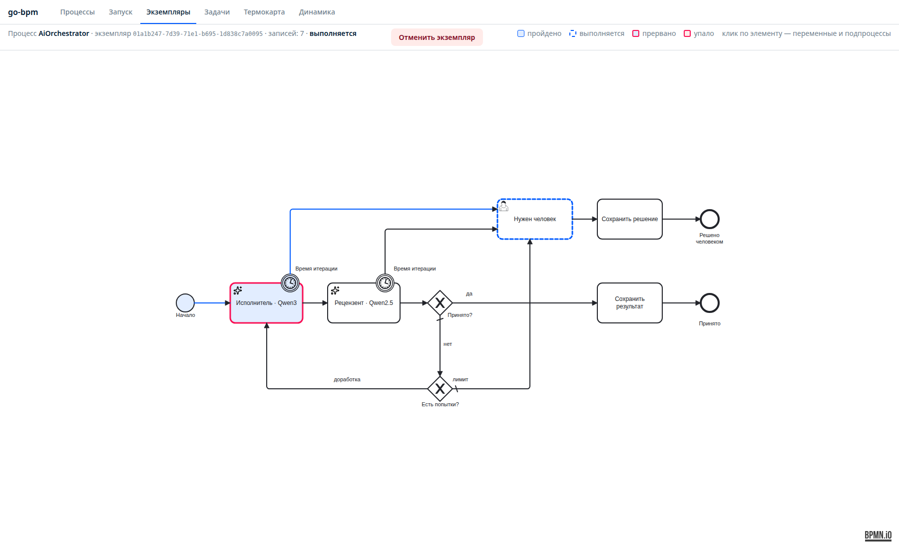
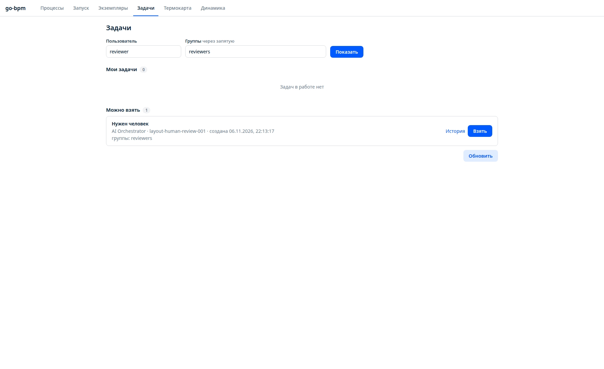
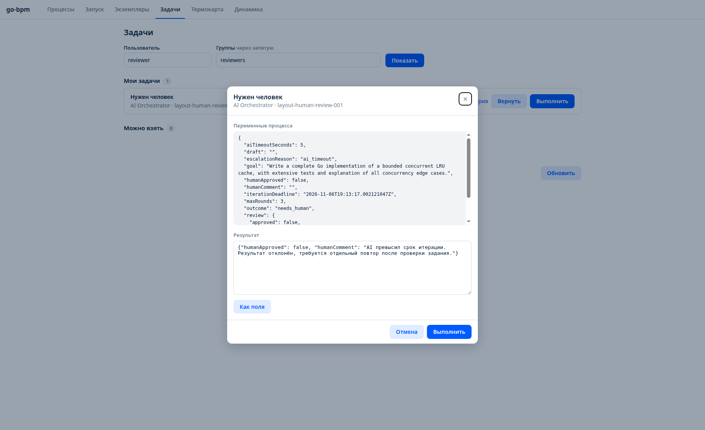
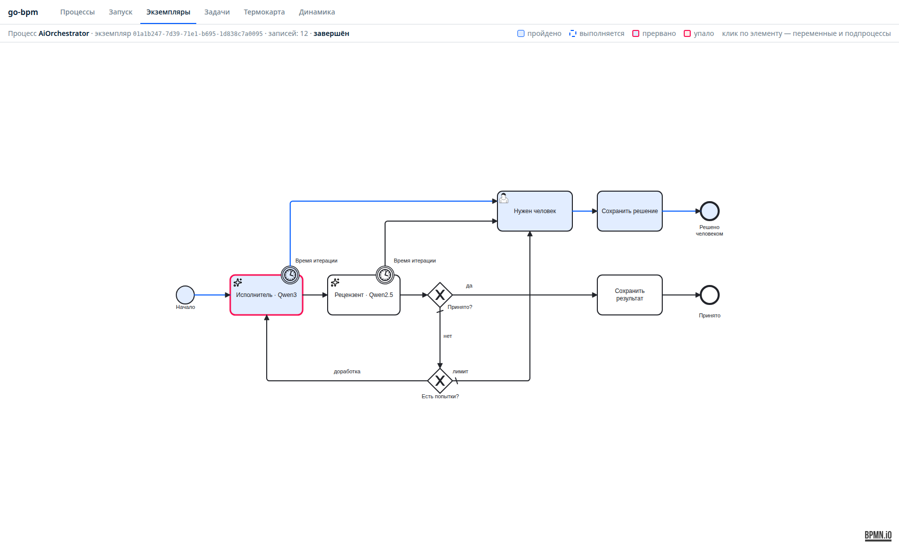

# Две LLM в BPMN: исполнитель, рецензент и человек

**go-bpm-ai-orchestrator** — тестовый проект, в котором одна модель готовит решение, другая проверяет его,
а go-bpm управляет доработкой, сроком и передачей задачи человеку. PostgreSQL хранит очередь, состояние и историю.
Каждый переход можно увидеть в стандартной консоли.

Мы прошли два сценария: исправление кода после замечаний рецензента и таймаут с ручным решением.
Первый показал также ограничение подхода: вторая модель одобрила код, который затем не прошёл компиляцию.

[Исходный код и запуск](https://github.com/nicolas-vp/go-bpm-ai-orchestrator) · [BPMN-схема](https://github.com/nicolas-vp/go-bpm-ai-orchestrator/blob/main/process/orchestrator.bpmn) · [Журнал эксперимента](https://github.com/nicolas-vp/go-bpm-ai-orchestrator/tree/main/docs/experiment)

## Зачем здесь BPMN

Идея возникла после статьи Максима Никитина
[«Оркестрация ИИ-агентов: когда нужно поправить в одном месте и не сломать всё остальное»](https://habr.com/ru/articles/1103656/).
Из неё взяли принцип: исполнитель сообщает о готовности, а отдельный рецензент проверяет результат;
состояние работы должно сохраняться вне сессии модели.

В нашем примере порядок работы задаёт BPMN. Модели генерируют решение и замечания, а процесс определяет,
когда повторить итерацию, когда остановиться и кому передать задачу. Лимит попыток и таймаут не зависят
от того, вспомнит ли модель об этих ограничениях в своём ответе.

Это небольшой эксперимент с генерацией и ревью текста и кода. У моделей нет доступа к shell,
файловой системе и GitHub. Компиляция, запуск тестов, merge и деплой не входят в их полномочия.

## Как устроена схема

На основном маршруте исполнитель получает цель, предыдущий черновик и замечания. Рецензент получает исходную цель
и новый черновик. Положительный вердикт завершает процесс, отрицательный возвращает его на доработку,
пока не исчерпан лимит. Таймаут любой AI-задачи и исчерпание попыток ведут прямо к задаче **«Нужен человек»**.



На снимке исполнитель уже прерван таймером, синяя ветка ведёт к человеку, а пунктирная рамка показывает ожидание его решения.
[Открыть схему в полном размере](/static/images/go-bpm-ai-orchestrator/layout-04-timeout.png).

Схему упростили в моделлере: убрали вспомогательные блоки «Следующая итерация», «Лимит исчерпан» и «Таймаут AI».
Подготовка итерации и запись причины эскалации выполняются в обработчиках переходов из пакета
`internal/orchestration`. Приложение дополняет сгенерированный граф через `orchestration.Processes(svc)`.
Отдельные технические блоки на диаграмме для этого не нужны.

## Две модели и один контракт ревью

| Роль | Модель на стенде | Что получает | Что возвращает |
|---|---|---|---|
| Исполнитель | `qwen3-coder:30b-32k` | Цель, предыдущий черновик и замечания | Текст решения в `draft` |
| Рецензент | `qwen2.5-coder:32b-8k` | Цель и последний черновик | JSON с `approved` и `feedback` |

Модели работают через Ollama. Каждый вызов содержит собственный system prompt и отдельный запрос,
без общей истории чата. Ответ рецензента имеет простой контракт:

```json
{
  "approved": false,
  "feedback": "Проверь обработку nil и убедись, что входной срез не изменяется."
}
```

Адаптер передаёт JSON Schema и дополнительно проверяет ответ: `approved` обязан быть boolean,
`feedback` — непустой строкой. Некорректный JSON считается технической ошибкой, а не отрицательным ревью.

На стенде используется RTX 3090 с 24 ГБ памяти. Для Qwen3 подтверждена загрузка всех 49 слоёв на GPU
и контекст 32768. Рецензент настроен на контекст 8192. Адаптер наследует параметры Modelfile,
вызовы идут последовательно, `keep_alive: 0` освобождает память после ответа.
Две большие модели не нужно держать в GPU-памяти одновременно. Это описание конфигурации эксперимента, а не замер скорости.

## Доработка, повторы и таймаут — разные механизмы

| Механизм | Когда включается | Что происходит |
|---|---|---|
| Доработка | Рецензент вернул `approved: false` | Новая итерация с замечаниями, до `maxRounds` |
| Технический повтор | Ошибка HTTP, пустой, обрезанный или некорректный ответ | Очередь повторяет AI-задачу; настроены 2 попытки |
| Бизнес-таймаут | Истёк общий срок итерации | AI-задача прерывается в BPMN, создаётся задача человека |
| Ручное решение | Истёк срок или исчерпаны итерации | Процесс ждёт пользователя группы `reviewers` |

По умолчанию разрешены 3 итерации, допустимый диапазон `maxRounds` — от 1 до 5.
У пары «исполнитель + рецензент» общий срок: `aiTimeoutSeconds`, по умолчанию 120 секунд, диапазон от 1 до 600.
Рецензент использует оставшееся время этой же итерации. При возврате на доработку срок начинается заново.

Граничные таймеры обеих AI-задач ссылаются на одну переменную `iterationDeadline` через `timeDate`.
Для наглядного прогона поставили 5 секунд и запросили развёрнутую реализацию конкурентного LRU-кеша.
Исполнитель не успел: процесс перешёл к человеку, не ожидая окончания генерации.

**Прерывание ветки BPMN не гарантирует остановку вычисления в Ollama.** Уже начатый HTTP-запрос может завершиться позже.
Движок отбрасывает его запоздалый результат: он не возобновляет прерванную ветку и не перезаписывает ручное решение.
Технический таймаут HTTP-попытки — 10 минут; это отдельное ограничение.

<details>
<summary>Как начинается итерация и проверяется её лимит</summary>

Обработчик входящего перехода к исполнителю проверяет параметры, увеличивает счётчик и записывает срок.
Это снимок рукописного кода проекта:

```go file=examples/go-bpm-ai-orchestrator/prepare.go.txt decl=prepare
```

Условие шлюза сгенерировано из BPMN:

```go file=examples/go-bpm-ai-orchestrator/cond_limit.go.txt decl=limit
```

[Обработчики переходов целиком](https://github.com/nicolas-vp/go-bpm-ai-orchestrator/blob/main/internal/orchestration/processes.go).

</details>

## «Нужен человек» — настоящая пользовательская задача

При входе в неё экземпляр остаётся `running`, `outcome` становится `needs_human`,
а `escalationReason` содержит `ai_timeout` или `iteration_limit`.
Задача появляется в стандартной консоли у кандидатов группы `reviewers`.



[Открыть очередь задач в полном размере](/static/images/go-bpm-ai-orchestrator/layout-05-human-task.png).

В нашем прогоне пользователь `reviewer` взял задачу, открыл «Выполнить» и передал решение с комментарием:

```json
{
  "humanApproved": false,
  "humanComment": "AI превысил срок итерации. Результат отклонён, требуется отдельный повтор после проверки задания."
}
```

Отдельная форма для этого не создавалась: используется обычный редактор переменных go-bpm.
Результат можно заполнить полями или JSON.



[Открыть решение человека в полном размере](/static/images/go-bpm-ai-orchestrator/layout-06-human-decision.png).

После завершения задачи метод «Сохранить решение» записывает окончательный исход, затем срабатывает End event.
Ручное одобрение здесь завершает процесс; оно не запускает новую итерацию модели автоматически.

| `outcome` | Смысл | Статус экземпляра |
|---|---|---|
| `accepted` | Решение одобрил LLM-рецензент | `completed` |
| `needs_human` | Ожидается решение человека | `running` |
| `approved_by_human` | Человек принял результат | `completed` |
| `rejected_by_human` | Человек отклонил результат | `completed` |

Для ручного одобрения нужно передать `humanApproved: true`. Если флаг не передан,
используется его значение из переменных процесса; в штатном запуске это `false`.
Технический сбой с исчерпанными повторами имеет отдельный статус `failed`.

<details>
<summary>Завершённый процесс после ручного отклонения</summary>



[Открыть завершённый процесс в полном размере](/static/images/go-bpm-ai-orchestrator/layout-07-human-completed.png).

</details>

## Что показала независимая проверка кода

В другом прогоне запросили функцию Go `UniqueSorted`: уникальные числа по возрастанию,
без изменения входного среза, с возвратом пустого среза `[]int{}` для nil и empty и табличными тестами.

На первой итерации исполнитель ошибся в вызове `copy`, рецензент вернул замечание.
На второй исполнитель поменял порядок аргументов, и рецензент ответил `approved: true`.
Процесс завершился с `round: 2`, `outcome: accepted`.

Но в принятом решении осталось:

```go
copy := make([]int, len(values))
copy(copy, values)
```

Переменная перекрывает встроенную функцию. Извлечённый Go-блок отдельно проверили через `go build ./...`:

```text
./main.go:17:5: invalid operation: cannot call copy (variable of type []int): []int is not a function
```

Кроме того, рецензент заявил, что тесты проверяют неизменность входного среза, хотя явной проверки в ответе нет.
Программа не запускалась: проверялась именно компиляция в отдельном временном модуле.

> **`accepted` означает согласие LLM-рецензента.** Это не подтверждение компиляции или прохождения тестов.
> Следующий этап развития примера — отдельная инструментальная проверка в изолированной среде.

[Полная история двух итераций](https://github.com/nicolas-vp/go-bpm-ai-orchestrator/blob/main/docs/experiment/real-run.json) · [Принятый Go-блок без исправления ошибки](https://github.com/nicolas-vp/go-bpm-ai-orchestrator/blob/main/docs/experiment/approved-output.go.txt).

## Как воспроизвести

Репозиторий самостоятельный: движок, генератор, API и консоль скопированы из go-bpm,
исходные демопримеры удалены. Соседний checkout движка для сборки не нужен.
Нужны доступная Ollama с установленными моделями и отдельная PostgreSQL.

В проекте есть конфигурация Docker Compose:

```sh
git clone https://github.com/nicolas-vp/go-bpm-ai-orchestrator.git
cd go-bpm-ai-orchestrator
cp .env.example .env
# Задайте POSTGRES_PASSWORD и доступный из контейнера OLLAMA_URL.
# WRITER_MODEL и REVIEWER_MODEL должны соответствовать моделям в вашей Ollama.
docker compose up -d --build
```

Имена `qwen3-coder:30b-32k` и `qwen2.5-coder:32b-8k` — локальные теги настроенных моделей нашего стенда.
Для другого сервера задайте свои имена. Консоль будет на `http://localhost:8092/ui/`;
порты Compose опубликованы только на localhost, база и том — собственные.

Чтобы увидеть таймаут, отправьте длинное задание с коротким сроком:

```sh
curl -fsS -X POST http://localhost:8092/api/v1/processes/AiOrchestrator/instances \
  -H 'Content-Type: application/json' \
  -d '{"businessKey":"timeout-example","variables":{"goal":"Write a complete Go implementation of a bounded concurrent LRU cache, with extensive tests and explanation of all concurrency edge cases.","aiTimeoutSeconds":5}}'
```

В ответе — `id`. Откройте `/ui/history/?instanceId=<id>` на своём стенде.
Если генерация займёт дольше 5 секунд, появится задача человека. Во вкладке «Задачи» укажите пользователя `reviewer`,
группу `reviewers`, возьмите задачу и завершите её с решением.
Короткий запрос модель может успеть выполнить до таймера — сам таймер не добавляет искусственную задержку.

В описанном эксперименте проверен локальный запуск из Go и работа с PostgreSQL.
Образ и запуск через Compose в этом прогоне не проверялись.

## Что проверено

С PostgreSQL и детектором гонок проходят шесть сценариев:
принятие моделью сразу, доработка и принятие, лимит с ручным принятием, лимит с ручным отклонением,
таймаут исполнителя и таймаут рецензента.
В тестах таймаута ответ модели удерживается до завершения ручного решения, затем обработчик освобождается.
Проверяется, что поздний ответ не меняет исход и комментарий, а активных таймеров после завершения не остаётся.
Эти тесты используют детерминированные ответы; живые модели проверены отдельно в описанных прогонах.

Также прошли генерация, сборка, `go vet` и CI. Состояние пережило перезапуск приложения:
после восстановления Ollama упавшую задачу повторили в том же экземпляре.
Все снимки сделаны с работающего приложения. Схема и исходный код статьи соответствуют версии
[`4ff7fd1`](https://github.com/nicolas-vp/go-bpm-ai-orchestrator/commit/4ff7fd1) от 6 ноября 2026 года.

[Разобрать код и повторить эксперимент](https://github.com/nicolas-vp/go-bpm-ai-orchestrator) · [AI task в справочнике BPMN](/docs/bpmn/#ai-task--запрос-к-модели) · [Задачи пользователей и API](/docs/api/) · [Тестирование процессов](/docs/testing/).
