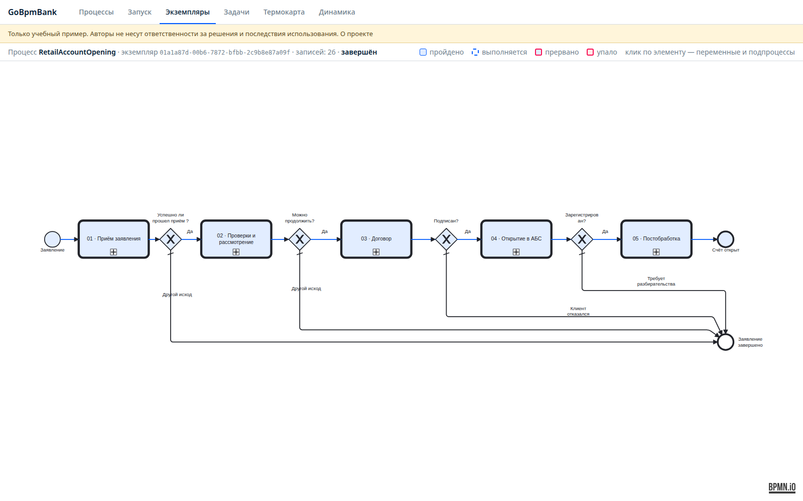
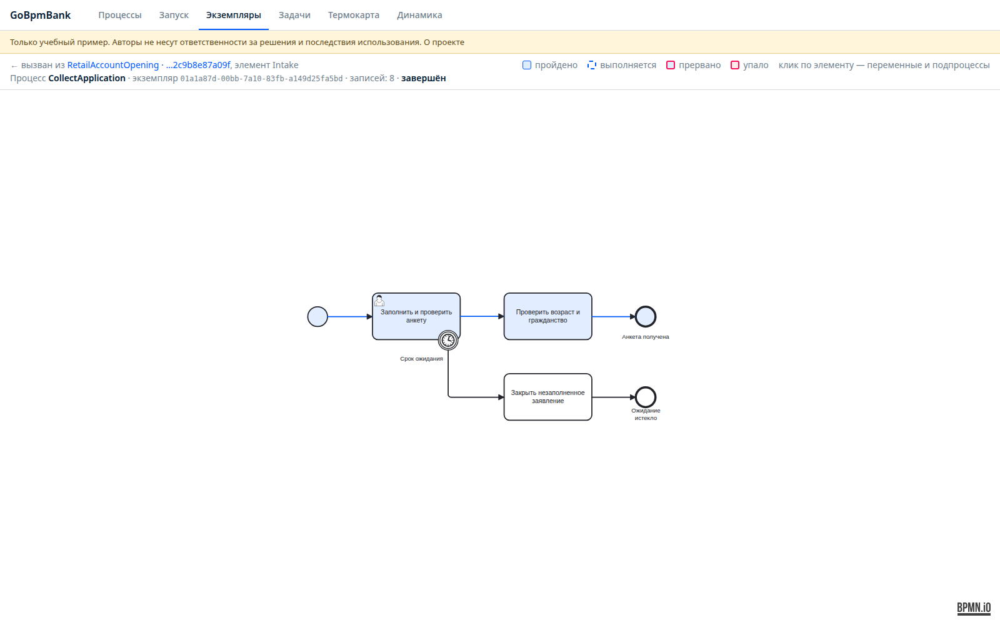
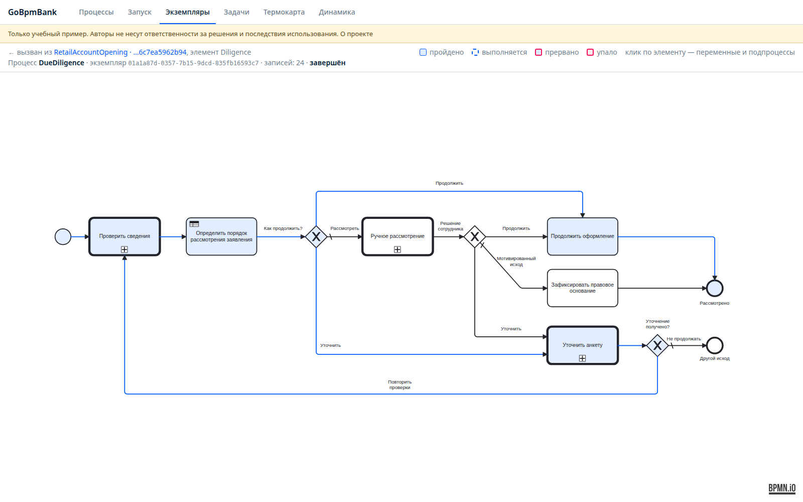
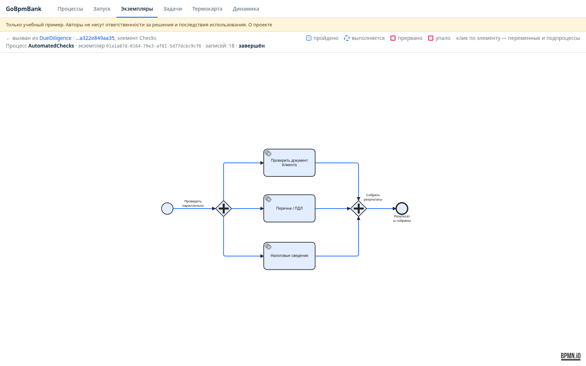
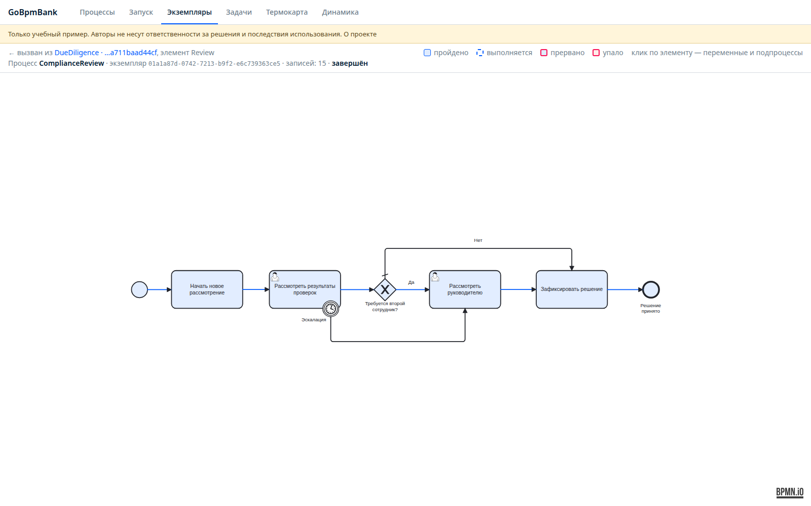
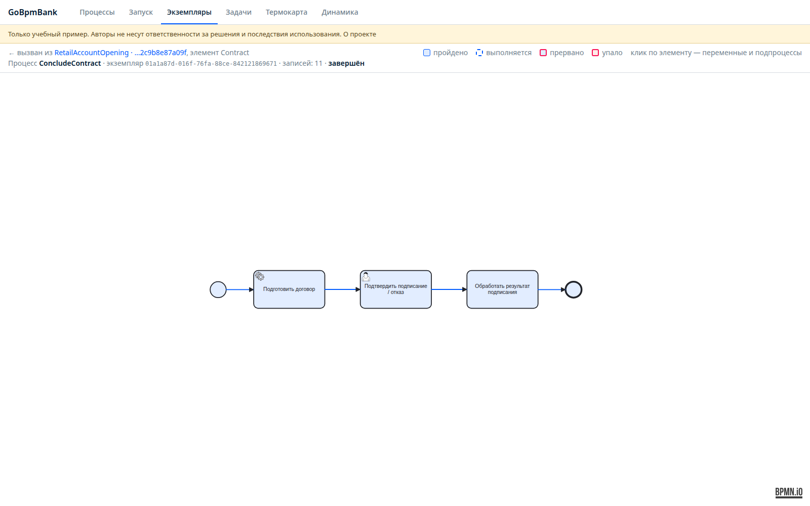
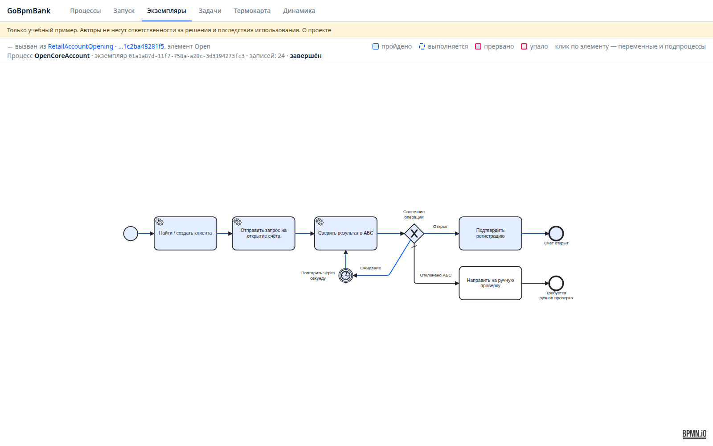
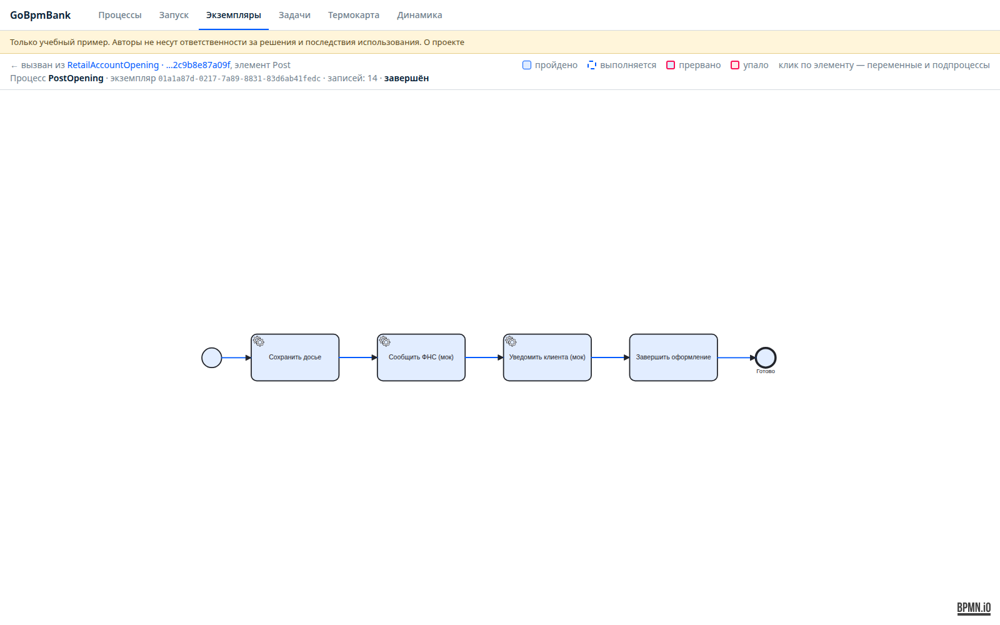
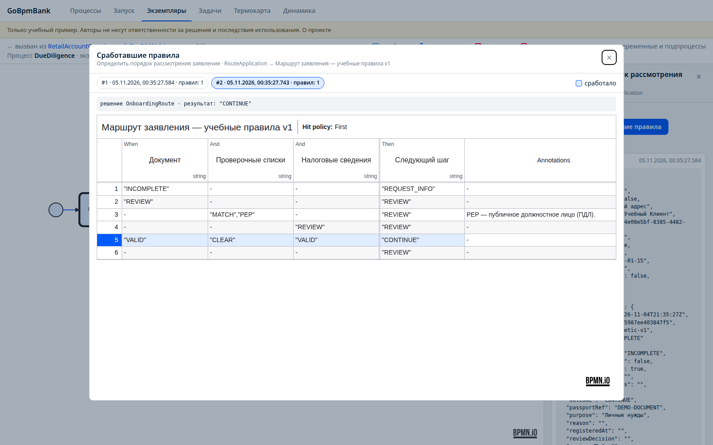
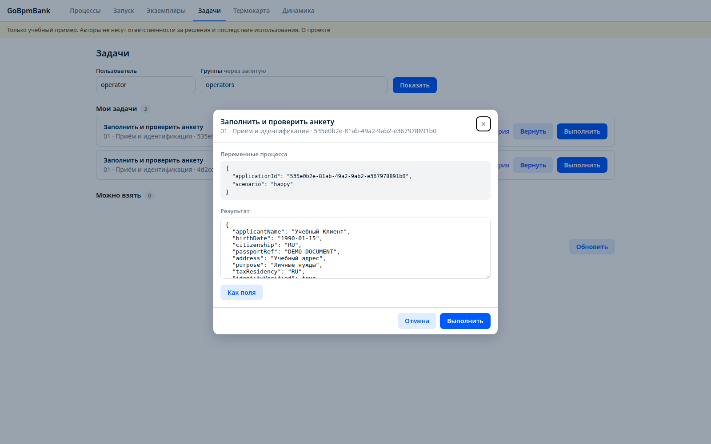

# Тестовый процесс открытия счёта для небольшого банка

> **Только для учебных целей.** GoBpmBank — пример применения go-bpm, а не готовая банковская система, юридическая консультация или регламент открытия счетов. Авторы не несут ответственности за решения, принятые на основе примера, и последствия его использования. Реальные счета не открываются, сведения государственным органам не отправляются. Используйте только вымышленные данные.

**GoBpmBank** показывает, как пройти путь от заявления клиента до регистрации счёта в условной АБС:
разделить большой процесс на подпроцессы, выполнить проверки параллельно, применить правила DMN,
дождаться решений сотрудников и пережить потерянный ответ внешней системы.

В примере новый совершеннолетний гражданин РФ лично обращается за **текущим рублёвым счётом для личных нужд**.
Кредит, вклад, выпуск карты, представители, несовершеннолетние и дистанционная идентификация в этот сценарий не входят.
Гражданство само по себе не определяет налоговое резидентство.

[Репозиторий GoBpmBank](https://github.com/nicolas-vp/go-bpm-bank) · [Возможности BPMN в go-bpm](/docs/bpmn/) · [HTTP API и консоль](/docs/api/)

## Что получилось

Один главный процесс и семь вызываемых процессов, отдельный HTTP-сервис мок-АБС и две базы PostgreSQL.
Оператор работает с анкетой и договором, сотрудник финансового мониторинга рассматривает результаты проверок,
руководитель согласует специальный случай. Пользовательские задачи завершаются переменными через стандартную консоль —
без отдельных форм и `formKey`.

GoBpmBank собран как самостоятельный клон go-bpm: движок, генератор, API и консоль находятся в одном проекте.
Базовые демонстрационные процессы удалены. Для каждого заявления сохраняются бизнес-ключ, история,
дочерние экземпляры и сработавшие правила.



[Открыть главный процесс в полном размере](/static/images/go-bpm-bank/03-main-process.png).

## Этап 1. Описать сценарий открытия счёта

Сначала отделяем требования законодательства от внутренних правил учебного банка и технического поведения системы.
Срок ожидания анкеты — внутренний SLA. Таймаут HTTP — техническая ошибка. Отказ клиента от договора — отдельный
бизнес-исход. Эти события нельзя сводить к одному флагу `approved`.

Для учебной модели выбраны следующие нормативные ориентиры. Исследование выполнено 4 ноября 2026 года;
перед практическим применением необходимо проверить действующие редакции и правила конкретного банка.

| Источник | Что учитываем в модели |
|---|---|
| [204-И, глава 1](https://www.consultant.ru/document/cons_doc_LAW_393919/01fbae25b3040955277cbd70aa1b907cceda878e/) | Идентификация, договор и момент открытия: счёт открыт после записи в Книге регистрации открытых счетов |
| [204-И, глава 3](https://www.consultant.ru/document/cons_doc_LAW_393919/395f0999655a2cf5baa0f40846ef88233ee0065f/) | Документы и сведения по закону и банковским правилам |
| [115-ФЗ, статья 7](https://www.consultant.ru/document/cons_doc_LAW_32834/3e3e0d20d2919071b55ef95f26f849df6a4f11e8/) | Идентификация, сведения о клиенте и различие оснований решений |
| [499-П, приложение 1](https://legalacts.ru/doc/polozhenie-ob-identifikatsii-kreditnymi-organizatsijami-klientov-predstavitelei/) | Состав идентификационных сведений; анкета в примере намеренно сокращена |
| [Банк России: разъяснения по 860-П](https://www.cbr.ru/explan/pcod/doc?number=26) | Правила внутреннего контроля; учебная DMN не заменяет ПВК банка |
| [НК РФ, статья 142.4](https://www.consultant.ru/document/cons_doc_LAW_19671/0c7748bb3297c9bbbb6feb83c158d25cc7f8b865/) | Сведения для установления налогового резидентства и отдельные основания решений |
| [НК РФ, статья 86](https://www.consultant.ru/document/cons_doc_LAW_19671/533942681580b9036225568f0c6f328a9827b834/) | Сообщение об открытии счёта; в примере оно направляется только мок-сервису |
| [152-ФЗ, статья 6](https://www.consultant.ru/document/cons_doc_LAW_61801/315f051396c88f1e4f827ba3f2ae313d999a1873/) | Основания обработки персональных данных; в стенде используются синтетические сведения |

В пункте 5.2 статьи 7 115-ФЗ физлица прямо исключены из описанного там основания отказа заключить договор из-за подозрений.
Поэтому возможное совпадение по перечню или статус ПДЛ в нашем процессе направляют заявление на рассмотрение,
а не вызывают автоматический отказ.

Учебный пример мотивированного отказа — непредставление запрошенной информации в случае, предусмотренном
пунктом 4 статьи 142.4 НК РФ. Для него используется внутренний код `NK142_4_NO_TAX_DATA`.
Это не официальный классификатор и не полный каталог оснований отказа.

## Этап 2. Разделить большой процесс

Главный процесс `RetailAccountOpening` вызывает этапы через **call activity**. Каждый вызов создаёт отдельный
дочерний экземпляр, связанный с родителем. После завершения подпроцесса его переменные возвращаются вызывающему процессу.

| Процесс | Ответственность |
|---|---|
| `RetailAccountOpening` | Связать этапы и проверить их бизнес-исходы |
| `CollectApplication` | Получить анкету, подтвердить идентификацию, проверить возраст и гражданство |
| `DueDiligence` | Выполнить проверки, применить DMN, запросить уточнение или ручное рассмотрение |
| `AutomatedChecks` | Параллельно проверить документ, перечни / ПДЛ и налоговые сведения |
| `ComplianceReview` | Рассмотреть результаты проверок и при необходимости получить второе согласование |
| `ConcludeContract` | Подготовить договор и обработать результат подписания |
| `OpenCoreAccount` | Отправить запрос в мок-АБС и подтвердить регистрацию счёта |
| `PostOpening` | Сохранить досье, подтвердить учебное сообщение ФНС и уведомление |

Так верхний уровень остаётся читаемым, а возвраты, таймеры и интеграционные детали видны в своих подпроцессах.
Механика вызова описана в [справочнике BPMN](/docs/bpmn/).

Схемы лежат в `process/`, а `make generate` превращает их в Go-код в `internal/bpmgen/`.
Имена задач и условия переходов берутся из BPMN. Генератор создаёт описание процессов, функции шлюзов и решений DMN;
код HTTP-клиентов и прикладные проверки переменных пишутся отдельно.

### Приём заявления

Оператор получает задачу **«Заполнить и проверить анкету»**, заполняет переменные и подтверждает личную проверку клиента.
Следующий шаг — **«Проверить возраст и гражданство»**. Случай за границами примера передаётся специалисту,
а не объявляется отказом банка. Граничный таймер закрывает незаполненное заявление после учебного срока ожидания.

<details>
<summary>Схема приёма заявления</summary>



[Открыть схему в полном размере](/static/images/go-bpm-bank/12-intake.png).

</details>

### Проверки и возврат за сведениями

`DueDiligence` вызывает три автоматические проверки, затем задачу **«Определить порядок рассмотрения заявления»**.
Если нужны дополнительные сведения, вызывается новая задача анкеты. После исправления проверки выполняются повторно.



[Открыть схему рассмотрения в полном размере](/static/images/go-bpm-bank/04-due-diligence.png).

Параллельный шлюз запускает три независимые ветки. Каждая проверка выполняется один раз, а шлюз слияния ждёт
все три результата. Даже возможное совпадение возвращается как результат проверки; решение о дальнейшем маршруте принимается после слияния.

<details>
<summary>Три параллельные проверки</summary>



[Открыть параллельные проверки в полном размере](/static/images/go-bpm-bank/05-parallel-checks.png).

</details>

### Ручное рассмотрение и второй сотрудник

Задача **«Рассмотреть результаты проверок»** назначена группе финансового мониторинга.
Сотрудник может разрешить ложное совпадение, запросить сведения, продолжить оформление или передать ситуацию на дальнейшее рассмотрение.
У решения есть обоснование. Для учебного случая ПДЛ требуется отдельное согласование руководителем.

При новом рассмотрении старые разрешения сбрасываются. Проверяющий и согласующий должны различаться;
эскалация по таймеру не позволяет обойти первое рассмотрение ПДЛ-кейса.

<details>
<summary>Схема ручного рассмотрения</summary>



[Открыть ручное рассмотрение в полном размере](/static/images/go-bpm-bank/08-compliance.png).

</details>

### Договор, АБС и постобработка

После подготовки договора оператор подтверждает подписание или отказ клиента. Шаг **«Обработать результат подписания»**
фиксирует этот исход. При отказе клиента запрос на открытие счёта в АБС не отправляется.

`OpenCoreAccount` находит или создаёт карточку клиента в мок-АБС, отправляет запрос на открытие и сверяет состояние операции.
Для завершения недостаточно получить номер: требуются `OPENED` и подтверждение регистрационной записи `registeredAt`.
Отложенная операция опрашивается через BPMN-таймер. Отклонённая команда приводит к исходу **«Требуется ручная проверка»**,
а не автоматически к юридическому отказу клиенту.

<details>
<summary>Договор и результат подписания</summary>



[Открыть схему договора в полном размере](/static/images/go-bpm-bank/13-contract.png).

</details>

<details>
<summary>Открытие в мок-АБС и ожидание результата</summary>



[Открыть схему интеграции в полном размере](/static/images/go-bpm-bank/06-core-opening.png).

</details>

После регистрации `PostOpening` сохраняет учебное досье, подтверждает сообщение ФНС и уведомление клиента.
Сбой этих действий не отменяет уже зарегистрированный в мок-АБС счёт: процесс повторяет действие или требует операционного вмешательства.

<details>
<summary>Постобработка открытого счёта</summary>



[Открыть постобработку в полном размере](/static/images/go-bpm-bank/14-post-opening.png).

</details>

## Этап 3. Вынести маршрутизацию в DMN

Таблица `OnboardingRoute` выбирает следующий шаг по результатам проверок. Hit policy **FIRST** означает, что срабатывает первое подходящее правило.

| Результат | Маршрут |
|---|---|
| Документ неполный | `REQUEST_INFO` — запросить сведения |
| Документ требует разбора, найдено совпадение или ПДЛ, налоговые сведения требуют рассмотрения | `REVIEW` — направить сотруднику |
| Все три проверки положительные | `CONTINUE` — продолжить оформление |
| Неизвестная комбинация | `REVIEW` — не считать отсутствие результата успешной проверкой |

`MATCH` — возможное совпадение с проверочным перечнем. `PEP` — публичное должностное лицо (**ПДЛ**).
Расшифровка PEP внесена в примечание таблицы. Сама таблица не принимает юридический отказ.



[Открыть таблицу DMN в полном размере](/static/images/go-bpm-bank/07-dmn-rules.png).

На снимке можно переключить результаты двух вызовов правила в работающей консоли:
до исправления анкеты и после него. Как решения компилируются в Go и записываются в историю — в [документации DMN](/docs/dmn/).

### Как выглядит сгенерированный Go-код

В `internal/bpmgen/due_diligence/decision_onboarding_route.go` таблица превращается в обычную Go-функцию:
она читает поля `DataModel`, проверяет правила по порядку и возвращает маршрут вместе с идентификатором сработавшего правила.
Ниже — код, сгенерированный для нашей таблицы, без ручного переписывания условий.

<details>
<summary>Посмотреть сгенерированную функцию решения DMN</summary>

```go file=examples/go-bpm-bank/decision_onboarding_route.go.txt decl=decideOnboardingRoute
```

</details>

Следующий exclusive gateway тоже компилируется в функцию. Файл `internal/bpmgen/due_diligence/cond_route.go`:

```go file=examples/go-bpm-bank/cond_route.go.txt decl=route
```

`Flow_4` ведёт к продолжению оформления, `Flow_5` — к уточнению анкеты, а `Flow_6` — к ручному рассмотрению.
Это идентификаторы переходов нашей схемы. Сгенерированный метод задачи вызывает решение и записывает его результат
и сработавшее правило в историю — поэтому их видно в консоли на скриншоте выше.

## Этап 4. Определить роли и переменные задач

Ручная задача — точка, в которой процесс **ждёт действия человека**. Например, автоматическая проверка нашла
возможное совпадение по перечню, но решить, тот ли это человек, должен сотрудник. Пока задача не выполнена,
следующий шаг этой ветки не запускается.

Для user task не нужен собственный Go-обработчик, который «ждёт сотрудника». Генератор создаёт описание задачи,
а движок сохраняет её состояние в PostgreSQL. Ниже — фрагмент сгенерированного
`internal/bpmgen/collect_application/flow-gen.go`: назначение группе `operators`, следующий переход
и прерывающий таймер на пять минут.

```go file=examples/go-bpm-bank/identify_applicant.go.txt
```

`FormKey` отсутствует: вместо отдельных экранов используем стандартный редактор переменных go-bpm.
Таймер здесь — учебный срок ожидания анкеты, а не установленный законом срок открытия счёта.

### Как сотрудник получает и выполняет задачу

1. В консоли открывает вкладку **«Задачи»**, указывает учебного пользователя и его группу.
2. Видит доступные задачи в списке **«Можно взять»**. После нажатия **«Взять»** задача закрепляется за ним и попадает в **«Мои задачи»**.
3. Нажимает **«Выполнить»**. В окне видны текущие переменные процесса; в разделе **«Результат»** он задаёт новые значения через поля или JSON.
4. Отправляет результат. Сервер проверяет исполнителя, допустимые поля, их типы и решение. При ошибке задача остаётся незавершённой.
5. После успешного завершения очередь продолжает BPMN-процесс: выполняет следующую задачу или выбирает ветку шлюза по новым переменным.

Кнопка **«Вернуть»** снимает закрепление за исполнителем и возвращает задачу в очередь кандидатов.
Её можно передать другому сотруднику, не завершая саму задачу. Перезапуск сервиса также не требует заново создавать
ожидающие задачи: они хранятся в базе вместе с состоянием процесса.

| Пользователь | Задачи | Примеры переменных |
|---|---|---|
| `operator` | Анкета, подтверждение подписания | `identityVerified`, `documentsComplete`, `contractAccepted`, `signedDocumentRef` |
| `aml` | Рассмотрение результатов проверок | `reviewDecision`, `reason`, `legalBasisCode` |
| `chief` | Согласование специального случая | `authorized`, `reviewDecision`, `reason` |

В запросе сотрудник не может присвоить себе произвольную группу: сервер берёт её из справочника учебных пользователей.
Выбор `userId` в стенде при этом не заменяет промышленную аутентификацию.

### Оператор: заполнить анкету и получить уточнение

`IdentifyApplicant` выполняет `operator` из группы `operators`. Он переносит сведения в анкету и подтверждает,
что лично проверил клиента и документ. Пример результата задачи с вымышленными данными:

```json
{
  "applicantName": "Учебный Клиент",
  "birthDate": "1990-01-15",
  "citizenship": "RU",
  "passportRef": "DEMO-DOCUMENT",
  "address": "Учебный адрес",
  "purpose": "Личные нужды",
  "taxResidency": "RU",
  "identityVerified": true,
  "documentsComplete": true
}
```

При `documentsComplete: false` анкету можно передать на проверки, но результат проверки документа будет `INCOMPLETE`.
DMN выберет `REQUEST_INFO`, и процесс создаст **новую задачу анкеты**. После получения сведений оператор снова передаёт
полную анкету, уже с `documentsComplete: true`; затем проверки выполняются повторно.
Предыдущая завершённая задача остаётся в истории.

Без подтверждения `identityVerified: true` или при некорректной дате рождения завершить задачу нельзя.
Если оператор не завершит её за пять минут, граничный таймер отменит эту задачу и переведёт заявление на ветку
**«Закрыть незаполненное заявление»**. Это отдельный исход `CLOSED_INCOMPLETE`.

### Финансовый мониторинг: рассмотреть результаты проверок

`ReviewClient` выполняет `aml` из группы `compliance`. Сотрудник читает результаты проверок и их свидетельства
в переменных процесса. Он должен указать **решение и обоснование**, а не просто нажать кнопку согласования.
Например, возможное совпадение оказалось ложным:

```json
{
  "reviewDecision": "CONTINUE",
  "reason": "Учебное совпадение разрешено как ложное",
  "legalBasisCode": ""
}
```

| `reviewDecision` | Что произойдёт дальше |
|---|---|
| `CONTINUE` | Оформление продолжится; для ПДЛ сначала потребуется отдельное согласование руководителем |
| `REQUEST_INFO` | Появится новая задача анкеты, после которой проверки повторятся |
| `REFER` | Заявление завершится исходом передачи на дальнейшее рассмотрение, без открытия счёта |
| `DECLINE` | Учебный мотивированный отказ, только при допустимом основании и соответствующих результатах проверки |

В нашем каталоге для `DECLINE` допустим только `legalBasisCode: "NK142_4_NO_TAX_DATA"` при `taxStatus: "REVIEW"`.
Произвольное «высокий риск» или совпадение ФИО не принимается вместо основания. Правовой контекст разобран
в [первом этапе](#этап-1-описать-сценарий-открытия-счёта).

Если `ReviewClient` не выполнена за две минуты, её прерывает учебный таймер эскалации, и создаётся новая задача руководителю.
Она не считается автоматически согласованной.

### Руководитель: согласовать специальный случай

Для ПДЛ после решения первого сотрудника создаётся `AuthorizeClient` для `chief` из группы `supervisors`.
Он проверяет обоснование и передаёт отдельный результат:

```json
{
  "reviewDecision": "CONTINUE",
  "authorized": true,
  "reason": "Проверены результаты и обоснование первого сотрудника"
}
```

Кто рассматривал и кто согласовал, сервер записывает в `reviewedBy` и `authorizedBy` сам — сотрудник не заполняет эти поля.
Один и тот же человек не может выступить обоими исполнителями. При новом рассмотрении старые согласования сбрасываются.

Если у ПДЛ-кейса ещё нет первого рассмотрения, руководитель после эскалации не может сразу разрешить продолжение:
можно запросить сведения или передать случай на дальнейшее рассмотрение. При `reviewDecision: "CONTINUE"` и
`authorized: false` ПДЛ-кейс получит исход `REFERRED` — это передача на дальнейшее рассмотрение, а не автоматический отказ банка.

### Оператор: подтвердить подписание или отказ клиента

`ConfirmContract` снова выполняет `operator`. Для подтверждения нужны два поля:

```json
{
  "contractAccepted": true,
  "signedDocumentRef": "DEMO-SIGNATURE-REFERENCE"
}
```

При `contractAccepted: true` без `signedDocumentRef` задача не завершится. Если клиент отказался, оператор передаёт
`contractAccepted: false`: шаг **«Обработать результат подписания»** установит `WITHDRAWN`, и запрос открытия в АБС не отправится.
Это учебное подтверждение действия, а не настоящая электронная подпись или юридически действительный договор.



[Открыть редактор задачи в полном размере](/static/images/go-bpm-bank/11-task-variables.png).
Контракт claim/complete и история задач описаны в разделе [«HTTP API и консоль»](/docs/api/).

### Те же действия через HTTP API

Для автоматизации можно получить очередь кандидата, взять конкретную задачу и отправить её результат.
Ниже — пример для сотрудника финансового мониторинга; вместо `TASK_UUID` нужен `task_uid` из ответа списка.
Адрес относится к локальному стенду GoBpmBank.

```sh
curl 'http://localhost:8090/api/v1/tasks?candidateUser=aml&candidateGroup=compliance'

curl -X POST 'http://localhost:8090/api/v1/tasks/TASK_UUID/claim' \
  -H 'Content-Type: application/json' \
  -d '{"userId":"aml"}'

curl -X POST 'http://localhost:8090/api/v1/tasks/TASK_UUID/complete' \
  -H 'Content-Type: application/json' \
  -d '{"userId":"aml","variables":{"reviewDecision":"CONTINUE","reason":"Учебное совпадение разрешено как ложное","legalBasisCode":""}}'
```

Успешные claim и complete возвращают `204`. Неподходящий кандидат или запрещённое поле — `403`,
попытка завершить задачу другим исполнителем либо уже завершённую/отменённую задачу — `409`.
Поля `accountOpened`, `accountId` и результаты проверок через complete изменить нельзя.

Назначение, исполнитель и результат остаются в истории пользовательской задачи. Из истории основного процесса можно
перейти в дочерний экземпляр и увидеть, на каком ручном шаге заявление ожидает решения и какие переменные были переданы.

## Этап 5. Подключить мок-АБС и обработать сбои

Предметный ориентир — **RS-Bank v.5.5**: [R-Style Softlab](https://www.softlab.ru/products/rs-bank/) позиционирует эту версию для малых и средних банков.
GoBpmBank использует собственный учебный REST-контракт. Это не реальный API RS-Bank, не подключение к продукту поставщика
и не заявление о партнёрстве или совместимости с ним.

Банк и `mock-core-banking` работают отдельными Go-сервисами. Данные движка находятся в базе `bank`,
операции мок-АБС — в `bank_core`. Для компактности тот же мок-сервис содержит логически отдельные проверки,
договор, архив, сообщение ФНС и уведомления.

| Контракт | Назначение |
|---|---|
| `POST /v1/customers/resolve` | Найти или создать учебную карточку клиента |
| `POST /v1/account-openings` | Принять команду открытия |
| `GET /v1/account-openings?requestId=...` | Сверить результат по устойчивому ключу |
| `GET /v1/account-openings/{operationId}` | Получить состояние и регистрационную запись |

Самый показательный сбой: **мок-АБС зарегистрировала счёт, но ответ потерялся**.
При повторе шага процесс сначала сверяет операцию по ключу `applicationId:opening:v1` и получает тот же счёт.
Идемпотентный ключ и хеш команды сохраняются в PostgreSQL. Повтор с изменённым телом под тем же ключом отклоняется.

Для заявления действует похожий принцип: запись заявки и `StartProcessTx` выполняются в одной транзакции.
Повтор одной команды возвращает существующий экземпляр. Технические повторы очереди сами по себе не дают
гарантии отсутствия повторного эффекта во внешней системе — устойчивый ключ нужен на её стороне.

Механика service task, очереди и повторов описана в разделах [«Генератор кода»](/docs/generator/) и [«Запуск и эксплуатация»](/docs/running/).

## Этап 6. Проверить процесс целиком

На отдельном локальном стенде выполнены десять сквозных сценариев. Последний прогон и скриншоты — **5 ноября 2026 года**.
Сборка, тесты Go и `go vet` прошли; исходная проверка с детектором гонок описана в документации проекта.

| Сценарий | Проверенный результат |
|---|---|
| Обычное заявление | Счёт зарегистрирован, постобработка подтверждена |
| Неполная анкета | Повторная задача оператору и повторные проверки |
| Возможное совпадение по перечню | Рассмотрение сотрудником и продолжение |
| ПДЛ | Отдельные решения проверяющего и руководителя |
| Непредставленные налоговые сведения | Учебный мотивированный отказ; счёт не открывается |
| Отказ клиента от договора | Заявление завершено без вызова открытия |
| Потерянный ответ АБС | Та же операция и один счёт при повторе |
| Отложенное открытие | Опрос, таймер, подтверждение регистрации |
| Отклонение команды АБС | Отдельный исход для ручного разбирательства |
| Потерянный ответ сообщения ФНС | Повтор того же учебного эффекта |

Статус BPMN-экземпляра `completed` означает, что процесс закончил работу, а не обязательно открыл счёт.
Деловой результат хранится отдельно в `outcome`: например, `OPENED`, `WITHDRAWN`, `DECLINED_WITH_BASIS` или `REFERRED_CORE`.

Код тестирования обычных Go-методов, условий и end-to-end проверок разбирается на странице [«Тестирование процессов»](/docs/testing/).

## Как попробовать и что учитывать

В рабочей копии GoBpmBank генерация и сборка выполняются локальными инструментами проекта:

```sh
make generate
make build
make test
make vet
```

Банк запускается с `BANK_DSN`, мок-АБС — с `MOCK_DSN`; это разные базы.
По умолчанию адреса стенда — `localhost:8090` и `localhost:8091`. После запуска обоих сервисов
`make e2e` выполняет десять сценариев с вымышленными данными, не очищая базы заявлений.
Эти адреса относятся к локальной установке, а не к публичному демо go-bpm.tech.

Docker Compose-конфигурация подготовлена, но в этом окружении не запускалась: проверены нативные Go-бинарники с PostgreSQL 16.15.
Банковские сроки, календарь рабочих дней, действительные подписи, форматы отчётности, полный ПВК,
промышленная аутентификация и реальные государственные проверки не реализованы.

Модель показывает оркестрацию и обработку ошибок. Для настоящего банка потребуются отдельное проектирование,
юридическая экспертиза, безопасность и полноценная интеграция с выбранной АБС.
