# go-bpm — BPMN-движок для Go на PostgreSQL

**Бизнес-процессы рисуются в BPMN, исполняются как обычный Go-код, а их состояние можно хранить в одной базе с данными сервиса.**

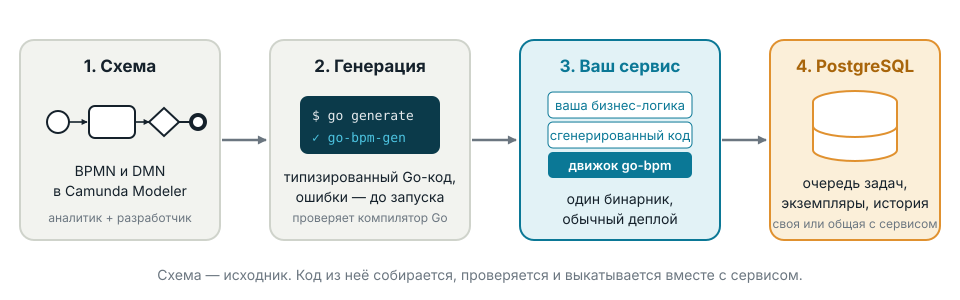

- Открытый проект, лицензия Apache 2.0
- Сайт и живое демо — [go-bpm.tech](https://go-bpm.tech/)
- Исходный код — [github.com/nicolas-vp/go-bpm](https://github.com/nicolas-vp/go-bpm)

---

## Какую задачу решает

Почти в каждом сервисе есть процесс: заявка проходит проверку, ждёт согласования, вызывает внешние системы, по таймеру
напоминает о себе. Обычно его реализуют одним из двух способов, и у обоих есть цена.

| Подход | Что получается | Цена |
|---|---|---|
| **Паттерн «Сага» или конечный автомат** | состояния и переходы в коде сервиса, оркестратор саги, компенсации, cron для таймеров, ретраи вручную | логика процесса размазана по коду; аналитик её не видит; повторы, таймеры и история каждый раз пишутся заново |
| **Отдельный BPM-движок** (Camunda, Zeebe, Temporal) | процесс виден на схеме или в коде workflow, есть история и консоль | отдельный кластер и его сопровождение, сетевые вызовы на каждом шаге, Java-экосистема или своя модель программирования, лицензии |

**go-bpm — третий путь.** Процесс по-прежнему рисуется в стандартной нотации BPMN и виден всем, но исполняет его
библиотека внутри вашего Go-сервиса. Не требует отдельной инфраструктуры: движку нужен только PostgreSQL — отдельная база или уже существующая.

---

## BPM без Java

Исторически BPM — это мир Java: Camunda, Flowable, jBPM, Activiti. Go-командам оставалось либо поднимать
Java-движок рядом и ходить в него по сети, либо писать статусы и ретраи руками. go-bpm приносит BPMN и DMN
в Go как обычную библиотеку — процесс становится частью лёгкого Go-сервиса.

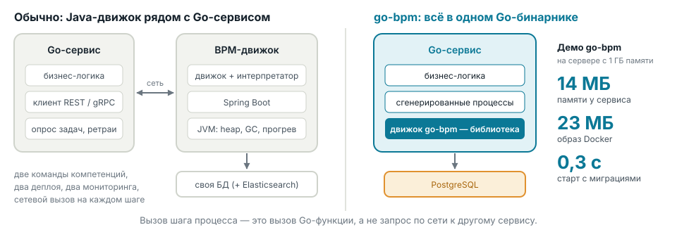

| | **Java-движок** | **go-bpm** |
|---|---|---|
| Что запускается | JVM, Spring Boot, движок — отдельный сервис или кластер | один статический Go-бинарник — ваш сервис |
| Ресурсы | память под heap, настройка GC, прогрев JIT | десятки мегабайт памяти, старт за доли секунды |
| Связь с бизнес-логикой | REST, gRPC, external task, job worker — по сети | вызов Go-функции в том же процессе |
| Команда | нужны компетенции Java и движка | только Go: тот же язык, тесты, линтеры, профилировщик |
| Kubernetes и облако | тяжёлые поды, долгий rolling update | маленький образ, быстрый старт и масштабирование |

---

## Основная концепция

### Схема — это исходник, код из неё генерируется

Классические движки читают BPMN во время работы и вычисляют выражения интерпретатором. go-bpm делает это заранее,
на этапе `go generate`:

1. **Аналитик и разработчик рисуют процесс** в Camunda Modeler: задачи, шлюзы, таймеры, задачи пользователей,
   таблицы решений DMN.
2. **Генератор `go-bpm-gen`** превращает схему в типизированный Go-код: переходы, условия шлюзов, скрипты, решения DMN.
   Для вашей логики он создаёт заготовки методов и обработчиков — и никогда их не перезаписывает.
3. **Компилятор Go проверяет всё**: опечатка в имени переменной, сравнение числа со строкой, неверная сигнатура
   метода — ошибка сборки, а не падение в продакшене.
4. **Движок исполняет процесс на очереди задач в PostgreSQL**: каждый шаг — задача очереди, все его эффекты —
   в одной транзакции.

Процесс согласования заказа — так он выглядит в моделере и так же в консоли go-bpm:

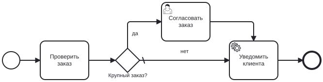

---

## Лучшее от low-code и code-first

go-bpm соединяет два подхода: процесс рисуется визуально, как в low-code, а исполняется и проверяется как обычный
код. Приложение разрабатывается целиком в одном цикле, без зоопарка технологий: быстро получить результат,
проверить его и переделать.

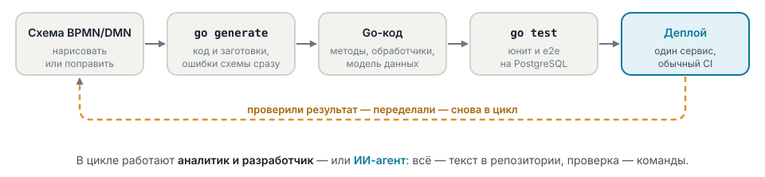

| | **Low-code платформа** | **Code-first** | **go-bpm** |
|---|---|---|---|
| Процесс виден на схеме | да | нет, только в коде | да, схема — исходник |
| Сложная логика | ограничена платформой | без ограничений | без ограничений: обычный Go |
| Git, ревью, CI | трудно: модель живёт в платформе | да | да: схема и код в одном репозитории |
| Проверка до запуска | в рантайме платформы | компилятор и тесты | генератор, компилятор и тесты |
| Работа ИИ-агентов | закрытая модель платформы | есть код, но процесс размазан по нему | всё — текст; схема, код и тесты рядом |

### Основа для ИИ-агентов

- **Всё — текст в репозитории:** BPMN и DMN — XML, логика — Go, тесты — Go. Агент читает и меняет их так же,
  как разработчик.
- **Быстрая и точная обратная связь:** `go generate`, `go build` и `go test` сразу говорят, что сломано —
  неизвестная переменная, неверный тип, упавший сценарий процесса.
- **Схема остаётся для людей:** результат работы агента можно проверить глазами на диаграмме, а не только
  в диффе кода.

---

## Как это устроено внутри

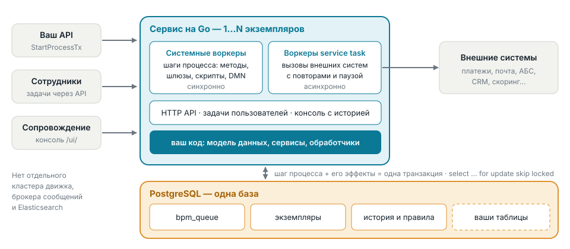

- **Шаг — одна транзакция.** Переход токена, изменение переменных, история и постановка следующей задачи
  коммитятся вместе. Упал сервис посреди шага — шаг повторится, а не оставит процесс в промежуточном состоянии.
- **База — на ваш выбор.** Движку можно выделить отдельную базу. А для простых или специфических задач процесс
  можно хранить рядом с бизнес-данными: тогда доступны общие транзакции — `StartProcessTx` запускает процесс
  в транзакции сервиса, и заказ с процессом его обработки появляются атомарно.
- **Горизонтальное масштабирование.** Несколько экземпляров сервиса работают на одной базе: воркеры берут задачи
  через `select … for update skip locked`, задача достаётся ровно одному из них.
- **Надёжные вызовы внешних систем.** Service task — асинхронно с повторами; не ответила система — граничный
  таймер или ошибка уведут в другую ветку, а callback процесс дождётся сообщением.

```go
err := pgx.BeginFunc(ctx, pool, func(tx pgx.Tx) error {
	if _, err := tx.Exec(ctx, `insert into orders (id, amount) values ($1, $2)`, orderID, amount); err != nil {
		return err
	}
	_, err := e.StartProcessTx(ctx, tx, "OrderApproval", map[string]any{"amount": amount},
		engine.WithBusinessKey(orderID))
	return err
})
```

---

## Что умеет


| Возможность | Что это даёт |
|---|---|
| Task, script task, service task | бизнес-логика на Go: синхронные шаги и асинхронные вызовы с повторами |
| Шлюзы exclusive и parallel | ветвление по условиям и параллельные ветки со слиянием |
| Таймеры и граничные события | «подождать час», «до 9:00 1 декабря», «если банк не ответил за 30 секунд — другая ветка», эскалация задачи сотрудника по сроку, обработка ошибок |
| Сообщения | процесс ждёт ответ внешней системы — оплату, подпись, решение бюро — и находит экземпляр по бизнес-ключу |
| Multi-instance (последовательный) | «согласовать до трёх кругов», «отправить три напоминания» — с числом выполнений и условием выхода |
| Подпроцессы и call activity | переиспользуемые куски процессов, вызов одного процесса из другого |
| Таблицы решений DMN | правила (скидки, лимиты, маршрутизация) меняются в таблице, а не в коде; компилируются в Go |
| Задачи пользователей | исполнитель, кандидаты и группы, очередь задач, «взять в работу» и «выполнить» через API |
| История и консоль `/ui/` | путь каждого экземпляра на диаграмме, сработавшие правила DMN, термокарта и динамика |
| Сопровождение | повтор упавшей задачи, исправление переменных и отмена экземпляра прямо из консоли |

Генератор отвергает неподдерживаемые элементы BPMN с понятной ошибкой: процесс, который сгенерировался, не упадёт
во время работы из-за непонятого элемента.

---

## Консоль: процесс виден целиком

Встроенная веб-консоль показывает процессы, экземпляры, задачи пользователей и историю каждого экземпляра прямо
на диаграмме BPMN.

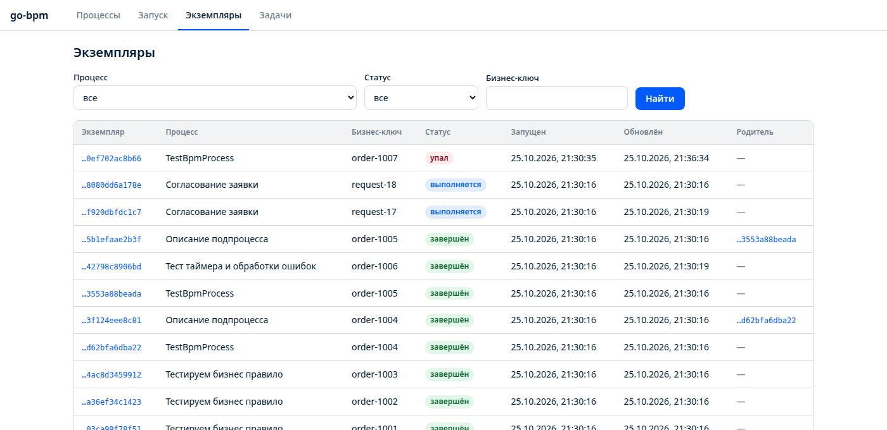


---

## Правила DMN и задачи сотрудников

Видно, какое правило таблицы решений сработало для конкретного экземпляра — удобно разбирать обращения клиентов
и проверять правила вместе с бизнесом.

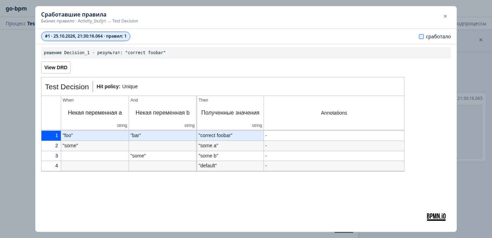

Задачи пользователей — очередь работы для сотрудников: кандидаты, группы, «взять в работу», «выполнить».

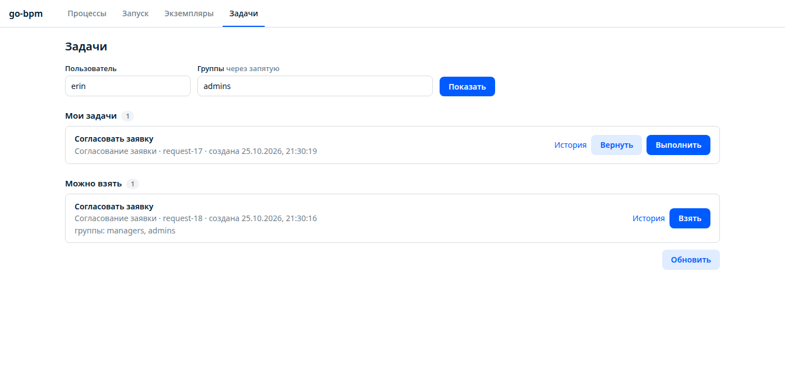

---

## Сопровождение в продакшене

Упавший экземпляр не теряется: видно, на каком шаге и с какой ошибкой он остановился. Его можно повторить, исправить
переменные или отменить — без SQL и без разработчика.

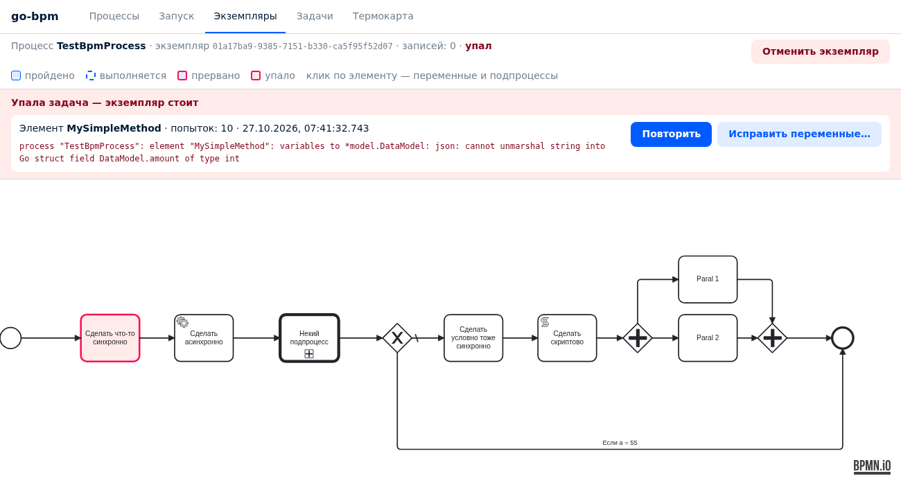

Термокарта показывает, где процесс проводит время: узкие места видны сразу. Для мониторинга — метрики Prometheus,
для трассировки — хуки под OpenTelemetry, история удаляется по сроку хранения.

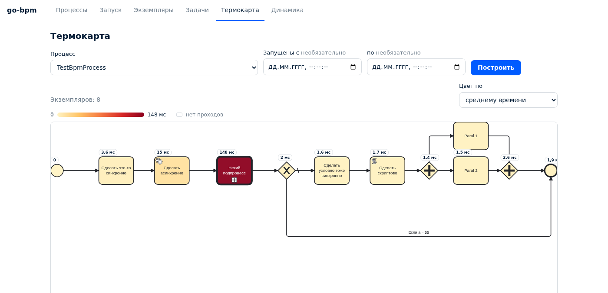

---

## Преимущества

| | |
|---|---|
| **Лёгкий Go-сервис вместо Java-движка** | один бинарник без JVM: демо занимает 14 МБ памяти, образ — 23 МБ, старт с миграциями — 0,3 с |
| **Нет новой инфраструктуры** | только PostgreSQL. Ни кластера движка, ни брокера сообщений, ни Elasticsearch. Движок — библиотека, выкатывается вместе с сервисом |
| **Надёжность по построению** | каждый шаг — транзакция; при общей базе старт процесса — в транзакции сервиса; повторы и аренда задач переживают падение пода |
| **Ошибки — до продакшена** | схема компилируется в Go; несуществующая переменная или неверный тип — ошибка сборки |
| **Типы вместо `map[string]any`** | методы получают Go-структуру модели данных; IDE, рефакторинг и линтеры работают как обычно |
| **Процесс версионируется с кодом** | BPMN лежит в репозитории, изменения проходят ревью и CI, выкатываются обычным деплоем |
| **Тестируется как обычный Go** | методы, условия и решения DMN — юнит-тестами; процесс целиком — e2e на PostgreSQL через `go test` |
| **Схема понятна бизнесу** | аналитик видит тот же процесс, что исполняется, — документация не расходится с кодом |
| **Встраивается в ваш проект** | свой HTTP-роутер и авторизация, свои миграции, своя модель данных; сгенерированный код не трогает рукописный |
| **Открытая лицензия** | Apache 2.0, без ограничений на продакшен и без платных редакций |

---

## Производительность

Нагрузочный тест повторяет методику статьи «Zeebe и Camunda: сравниваем известные BPM-системы под высокими
нагрузками» (Хабр, 2021) на той же машине: Intel Core i7-4770K, 4 ядра. 100 тысяч экземпляров процесса
«старт → два REST-вызова → конец», медиана трёх прогонов.

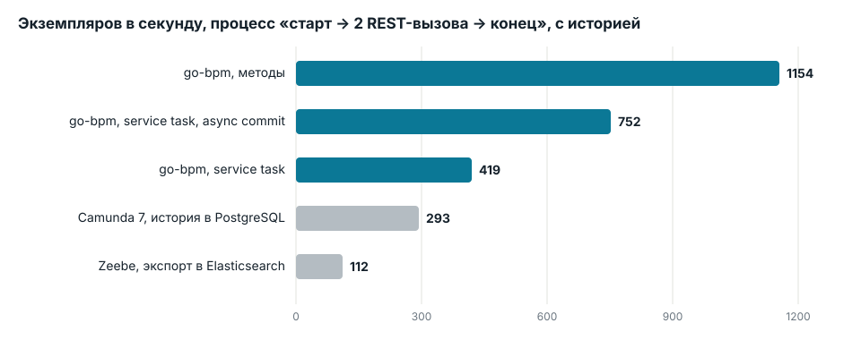

- **С историей в PostgreSQL** go-bpm в 1,4–4 раза быстрее Camunda 7 и в 4–10 раз быстрее Zeebe на том же железе.
- **История стоит 10–15%**: она пишется в той же транзакции, что и переход токена.
- **Без истории** — около 1360 экземпляров в секунду, уровень Camunda без истории на H2 в памяти (1577), но у go-bpm
  каждый шаг закоммичен на диск.
- Потолок — диск и PostgreSQL, а не движок. Цифры статьи — 2021 года; сравнение по порядку величин.
  Методика и все прогоны — [go-bpm.tech/docs/performance](https://go-bpm.tech/docs/performance/).

---

## Сравнение с аналогами

| | **go-bpm** | **Camunda 7** | **Camunda 8 (Zeebe)** | **Temporal** | **Flowable** |
|---|---|---|---|---|---|
| Язык сервисов | Go | Java | любой (job workers) | Go, Java и др. (SDK) | Java |
| Модель процесса | BPMN + DMN | BPMN + DMN | BPMN + DMN | код workflow | BPMN + CMMN + DMN |
| Как исполняется | сгенерированный Go-код | интерпретатор в рантайме | интерпретатор в кластере | детерминированный replay кода | интерпретатор в рантайме |
| Инфраструктура | библиотека + PostgreSQL | встраиваемый или отдельный сервер + РСУБД | кластер Zeebe + Elasticsearch/OpenSearch | кластер Temporal + БД | встраиваемый или отдельный сервер + РСУБД |
| Общие транзакции с данными сервиса | возможны, если база общая | да (embedded) | нет | нет | да (embedded) |
| Проверка процесса | компилятором Go на сборке | в рантайме | в рантайме | компилятором (это код) | в рантайме |
| Обновление процесса | вместе с деплоем сервиса | деплой BPMN на лету | деплой BPMN на лету | версионирование кода workflow | деплой BPMN на лету |
| Схема понятна аналитику | да | да | да | нет | да |
| Лицензия | Apache 2.0 | Apache 2.0, развитие Community-версии завершено | для продакшена self-managed — коммерческая | MIT | Apache 2.0 |

**Когда выбирать go-bpm:** сервисы на Go, PostgreSQL уже есть, процессы — часть продукта и живут в репозитории
сервиса, команда не хочет сопровождать отдельный BPM-кластер.

**Когда смотреть на другие:** процессы должны меняться без релиза сервиса; нужна полная нотация BPMN (сигналы,
компенсации, параллельный multi-instance, event-based gateway); основной стек — Java; нужна межсервисная оркестрация на десятках языков.

---

## Как компания может использовать go-bpm

| Направление | Пример процесса | Что даёт go-bpm |
|---|---|---|
| **Финансы и кредитование** | заявка → скоринг (DMN) → проверки параллельно → решение андеррайтера → выдача | правила скоринга в таблицах, история решений по каждой заявке, повторы вызовов АБС и бюро |
| **E-commerce и логистика** | заказ → резерв → оплата с таймаутом → сборка → доставка → уведомления | таймеры отмены неоплаченных заказов, ретраи к платёжному шлюзу |
| **Онбординг клиентов (KYC)** | анкета → проверка документов → ручная верификация → активация | очередь задач для сотрудников, подпроцесс KYC переиспользуется в разных продуктах |
| **Внутренние согласования** | заявка → руководитель → бухгалтерия → исполнение | процесс виден на схеме, сотрудники работают с задачами через API, история для аудита |
| **Интеграции** | выгрузка → преобразование → отправка в несколько систем с подтверждением | надёжная оркестрация вызовов вместо самописных ретраев и cron |
| **Тарифы и лимиты** | расчёт скидки, лимита, маршрута обращения | DMN-таблица, которую бизнес читает и проверяет сам, а исполняет скомпилированный Go |

### Кому в компании это полезно

- **Бизнесу и аналитикам** — процесс описан схемой, которая и исполняется; видно, где застревают заявки.
- **Разработчикам** — обычный Go, типы, тесты, ревью; никакого нового языка выражений и отдельного сервера.
- **Эксплуатации** — нет новой инфраструктуры; метрики Prometheus, упавшие экземпляры чинятся из консоли.
- **Безопасности и аудиту** — история каждого экземпляра и сработавших правил хранится в своей базе компании;
  образ подписан cosign, к нему приложены SBOM и provenance, зависимости проверяет govulncheck.

---

## Внедрение

1. **Демо — 5 минут.** Живое демо на [go-bpm.tech/demo](https://go-bpm.tech/demo/) или локально: `docker compose up -d`,
   консоль на `localhost:8080/ui/`.
2. **Пилот — один процесс.** Выбрать процесс, который сейчас реализован статусами и cron. Нарисовать его в Camunda
   Modeler, подключить go-bpm к существующему сервису:

   ```sh
   go get github.com/nicolas-vp/go-bpm
   go get -tool github.com/nicolas-vp/go-bpm/cmd/go-bpm-gen
   go generate ./...
   ```

3. **Тесты и CI.** Юнит-тесты методов и решений, e2e процесса на PostgreSQL, проверка в CI, что `go generate`
   не даёт diff.
4. **Продакшен.** Миграции таблиц движка — `migrations.Up` (безопасно при одновременном старте подов); масштабирование —
   числом воркеров и подов.

### Честно об ограничениях

- Поменять процесс можно только релизом сервиса — деплоя BPMN «на лету» нет.
- Поддерживается подмножество BPMN: нет сигналов, старта по сообщению, inclusive и event-based gateway,
  параллельного multi-instance, компенсаций.
- Только Go и только PostgreSQL.
- Проект молодой: первая версия v0.1.0 вышла в октябре 2026 года.

---

## Дополнительная информация

- Сайт, документация и живое демо — [go-bpm.tech](https://go-bpm.tech/)
- Исходный код — [github.com/nicolas-vp/go-bpm](https://github.com/nicolas-vp/go-bpm)
